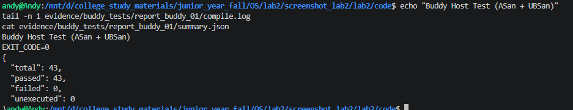
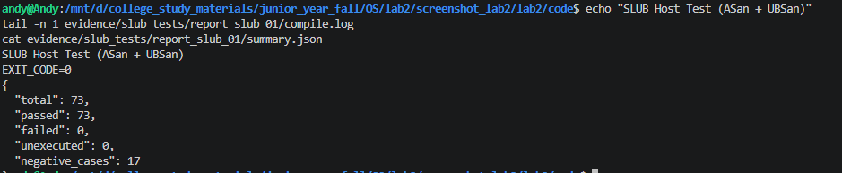
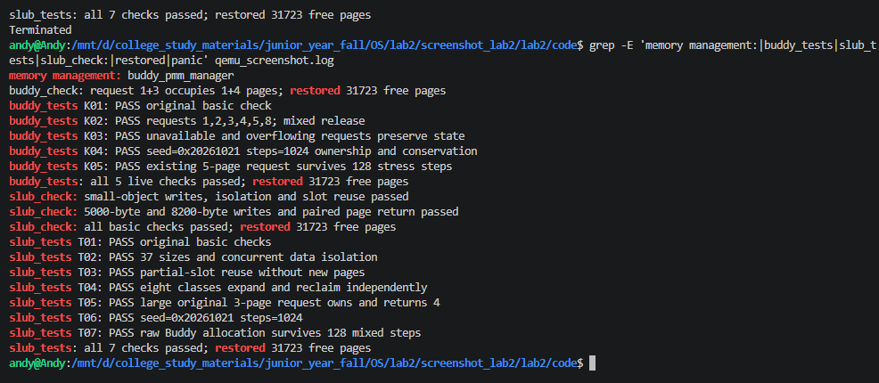

# 操作系统实验报告

## 实验基本信息

| 项目 | 内容 |
|---|---|
| 实验名称 | Lab2:物理内存和页表 |
| 小组成员 | 张宸笛号—2412565、朱泽帅—2411560、马梓涵—2413902 |
| 完成日期 | 2026.10.23 |

### 小组分工

实验如何分工：

| 成员 | 负责的练习/模块 |
|---|---|
| 张宸笛号—2412565 | 负责物理内存探测与 `page_init()` 初始化、First-Fit 分析、Best-Fit 算法实现及对应 SPEC、Prompt 和测试；主要承担上述模块的代码编写与调试。 |
| 朱泽帅—2411560 | 负责 Buddy System、SLUB Challenge 的实现与专项测试，以及对应 SPEC、Prompt 和验证记录；主要承担上述模块的代码编写、测试代码编写与调试。 |
| 马梓涵—2413902 | 负责实验整体逻辑分析，梳理启动映射、物理页管理与对象分配的依赖关系；合作完成资料整理、报告整合与内容核对。 |

其余实验工作：三人合作。

实验报告如何分工：

| 报告部分 | 分工 |
|---|---|
| 实验基本信息、一、实验目的、二、实验环境 | 三人合作 |
| 三、实验整体逻辑分析 | 马梓涵—2413902 |
| 4.1 物理内存探测与页描述符初始化、4.2 First-Fit 分析、4.3 Best-Fit 实现 | 张宸笛号—2412565 |
| 4.4 Buddy System、4.5 SLUB Challenge | 朱泽帅—2411560 |
| 五、测试与验证 | 三人合作，分别整理各自模块的测试记录并共同核对 |
| 六、实验知识点与操作系统原理的对应 | 三人合作 |
| 七、重要但本实验未完整实现的 OS 原理知识点 | 三人合作 |
| 全文整合、格式整理与最终检查 | 三人合作 |

---

## 一、实验目的

本实验在 Lab1 内核启动的基础上，引入分页机制与物理内存管理，使内核能够识别可用 RAM、维护物理页状态，并向上层提供内存分配与释放服务。具体目标如下：

1. **理解页表的建立和使用方法。** 掌握 RISC-V Sv39 的虚拟地址划分、页表项、`satp` 和 TLB 的作用，结合启动代码理解内核如何通过预设页表访问高地址虚拟空间。
2. **理解物理内存的发现与初始化。** 掌握从设备树读取内存起点与大小的方法，理解 `page_init()` 如何设置地址转换关系、建立 `Page` 描述符数组，并排除固件、内核和管理数据占用的页面。
3. **理解物理页管理框架。** 掌握 `struct Page`、空闲链表和 `struct pmm_manager` 的关系，理解初始化、连续页分配、释放、合并及空闲页计数等接口的职责。
4. **理解并比较页面分配算法。** 在分析 First-Fit 的基础上实现 Best-Fit 与 Buddy System，理解不同选块、拆分和合并策略对连续内存分配及内外部碎片的影响。
5. **理解对象分配与验证方法。** 通过简化 SLUB 扩展理解“底层分配整页、上层分配对象”的两层结构；围绕接口约束、边界条件和资源守恒设计 SPEC、Prompt 与测试，并区分宿主机测试和目标内核测试的作用。

---

## 二、实验环境

### AI 工具使用情况

| 成员 | AI 编程工具 | 底层模型 | 备注 |
|---|---|---|---|
| 张宸笛号—2412565 | ChatGPT | GPT-5 | |
| 朱泽帅—2411560 | ChatGPT | GPT-5 | |
| 马梓涵—2413902 | ChatGPT | GPT-5 | |

---

## 三、实验整体逻辑分析

**负责人：2413902-马梓涵**

### 3.1 本章节的逻辑主线

本章围绕“**内核如何访问、识别、组织并分配物理内存**”展开。页表首先解决地址访问问题：内核使用虚拟地址，MMU 根据页表将其转换为物理地址，并检查访问权限；TLB 缓存近期的地址转换结果，以减少查表开销。物理内存管理随后解决资源管理问题：确定哪些 RAM 页面可以使用，记录页面状态，并按照指定算法完成分配与回收。

两者相互配合，但职责不同：**页表决定虚拟地址映射到哪里，物理页分配器决定哪些物理页可以分配给调用者。** `struct Page` 是记录物理页状态的管理数据，并不是页表项，也不是该页实际存放数据的地址。SLUB 则在物理页分配器之上进一步管理以字节为单位的内核对象。

从工程结构看，实验可分为以下层次：

| 层次 | 关键文件/接口 | 主要职责 |
|---|---|---|
| 启动与地址映射 | `kern/init/entry.S`、`tools/kernel.ld`、`satp` | 准备启动页表，启用 Sv39，进入高虚拟地址的内核执行环境 |
| 内存信息获取 | `kern/driver/dtb.c`、`dtb_init()` | 解析启动时传入的设备树，保存 RAM 起点与大小 |
| 页管理初始化 | `kern/mm/pmm.c`、`page_init()` | 建立描述符数组，划定保留区与可分配完整页区间 |
| 物理页分配策略 | `pmm_manager`、First-Fit、Best-Fit、Buddy | 维护空闲页，完成连续页申请、释放及合并 |
| 对象分配扩展 | `kern/mm/slub.c` | 从底层取得页面，再管理页内小对象与大对象分配 |
| 调试与验证 | 各管理器的 `check()`、Host 测试、QEMU/GDB | 检查接口行为、数据隔离、边界处理及资源恢复 |

其中，物理内存管理的主调用链是：

```text
kern_init()
  ├─ 清零 BSS、dtb_init()、控制台及内核信息输出
  ├─ pmm_init()
  │    ├─ init_pmm_manager()：选择并初始化一种物理页分配器
  │    ├─ page_init()：读取 RAM 信息，建立 Page 数组并划分可用页
  │    │    └─ init_memmap()：将可用页登记到当前分配器
  │    └─ check_alloc_page()：调用当前分配器的 check()
  └─ slub_init()、slub_check()：在物理页服务之上初始化并检查对象分配

后续页面申请与释放：
alloc_pages(n) / free_pages(base, n)
  └─ 当前 pmm_manager 对应的分配/释放回调
```

这个顺序有明确的依赖关系：设备树信息必须先于页范围计算准备好；管理器必须先初始化，才能接收空闲页登记；可用页必须登记后，才能进行真实分配；SLUB 又依赖已经可用的物理页接口。First-Fit、Best-Fit 与 Buddy 是可替换的物理页策略，并非启动时依次执行的三个分配阶段。当前仓库选择 `buddy_pmm_manager`，Best-Fit 的内核验证需要在相应构建中切换管理器。

### 3.2 功能的逐步实现

1. **先理解启动页表与地址转换，建立后续内存操作的基础。** Lab2 将内核链接到 `0xffffffffc0200000` 附近的高虚拟地址，而镜像的物理装载起点仍为 `0x80200000`。启动代码利用预设页表、`satp` 和 `sfence.vma` 建立访问条件，再进入 C 入口。当前启动页表在根级使用叶子项，将高地址区域映射到从 `0x80000000` 开始的物理地址区域，一条映射覆盖 1 GiB；这表示映射范围，不表示实际拥有 1 GiB RAM。只有先区分虚拟地址、物理地址、物理页号和描述符地址，后续布局计算才不会混用单位或地址空间。

2. **再完成物理内存发现与 `page_init()`，确定分配器能管理的资源。** 启动时保存固件通过 `a1` 传入的 DTB 物理地址，进入 C 后先清零 BSS，再由 `dtb_init()` 解析内存信息。`page_init()` 读取 `get_memory_base()` 与 `get_memory_size()`，检查范围有效性，设置 `va_pa_offset`、物理页号上界 `npage` 和描述符数组 `pages`，并保留固件、内核及描述符数组占用的页面。数组之后的空闲起点向上按页对齐，内存末端向下按页对齐，只有非空的完整页区间才交给 `init_memmap()`。这一步提供分配器正确运行所需的初始状态，避免把管理数据本身再次分配出去。

3. **接着分析 First-Fit，理解公共管理接口与空闲块操作。** 通过 `default_init()`、`default_init_memmap()`、`default_alloc_pages()` 和 `default_free_pages()`，理解空闲链表的建立、首个足够大空闲块的选择、剩余块拆分、释放后的有序插入及相邻块合并。重点掌握块首页的 `property`、页面状态标志和 `nr_free` 的维护方式，为实现其他策略提供接口与数据结构基础，同时分析线性查找和外部碎片的改进空间。

4. **在相同框架下实现 Best-Fit，比较不同选块策略。** Best-Fit 从满足请求的空闲块中选择最小者，之后仍需正确拆分、释放和合并。实现时依据 `pmm.h` 的 `struct pmm_manager` 补齐回调与 `best_fit_pmm_manager`，保留课程提供的 `basic_check()`、`best_fit_check()`，并在 `init_pmm_manager()` 中选择该管理器后验证。该阶段说明：公共接口保持一致，分配策略可以替换；Best-Fit 有助于减少单次分配后的剩余块大小，但不能保证始终具有更低的碎片率。

5. **进一步实现 Buddy System，研究按阶拆分和伙伴合并。** Buddy 将空闲空间组织成大小为 `2^k` 页的块，分配时逐级拆分较大块，释放时仅合并满足同阶、伙伴关系和管理边界约束的空闲块。与 First-Fit、Best-Fit 相比，它改变了块的组织与合并方式，并引入请求大小向上取整的内部碎片问题。因此需要先明确非幂请求、实际占用页数和配对释放的契约，再分别设计实现 Prompt 与测试 Prompt，验证对齐、拆分、合并、失败处理及空闲页守恒。

6. **最后在物理页分配器之上扩展简化 SLUB，支持不同大小的内核对象。** 直接为小对象分配整页会浪费空间，SLUB 因而复用底层 `alloc_pages()`、`free_pages()`，将页面组织为 Slab，并通过大小类和空闲槽位管理小对象；较大对象则转到底层连续页分配路径。它依赖 PMM，却不替代 `pmm_manager`。测试需覆盖对象大小边界、页内复用、对象数据隔离、大对象释放以及空 Slab 回收，检查全部对象释放后底层物理页是否恢复。

7. **结合分支调试任务，理解地址转换的实际执行过程。** 借助带调试信息的 QEMU 和 GDB，观察一次访存中的 TLB 查询与页表遍历，区分 TLB 命中、TLB 未命中后成功查表，以及页表无效或权限不符导致的异常。该任务与分配算法实现相互补充：前者观察地址怎样被转换，后者检查物理内存怎样被分配。相关调试过程和结论应由实际记录支撑，不能仅由分配器自检通过推断已经完成。

---

## 四、实验内容与实现

### 4.1 功能模块一 · 任务一：物理内存探测与页描述符初始化

**负责人：2412565—张宸笛号**

#### 4.1.1 功能与接口理解

目标函数是 [kern/mm/pmm.c](../code/kern/mm/pmm.c) 中的 `static void page_init(void)`。它将“设备树报告的物理内存范围”转换为“分配器可以管理的页描述符和初始空闲区”，不承担后续选块策略。`pmm_init()` 先初始化当前管理器，再调用它，保证登记空闲页时管理器的链表或其他内部状态已经就绪。

`get_memory_base()` 返回物理起始地址，`get_memory_size()` 返回字节长度，因此内存范围使用左闭右开区间 `[mem_base, mem_base + mem_size)`。这里不能把大小当成末地址，也不能将设备树输出的包含式末地址与管理区间的排他上界混用。

与该函数直接相关的状态如下。

| 名称 | 含义及作用 |
|---|---|
| `va_pa_offset` | 当前内核映射的虚实地址偏移，`PADDR(kva)` 使用它换算地址 |
| `nbase` | `DRAM_BASE / PGSIZE`，即描述符索引对应的起始物理页号 |
| `npage` | `PPN(mem_end)`，可管理完整物理页的页号排他上界 |
| `pages` | 描述符数组的内核虚拟地址，不是物理内存起始地址 |
| `end` | 链接脚本给出的内核镜像结束虚拟地址符号 |
| `Page.ref`、`flags`、`property` | 页面引用计数、状态标志和空闲块长度等管理信息 |

描述符数组元素数为 `npage - nbase`。物理地址 `pa` 对应的下标是 `PPN(pa) - nbase`，反向物理地址为 `(page - pages + nbase) << PGSHIFT`。描述符位于内核虚拟地址空间，描述的是物理页；`struct Page *` 的指针值不能直接作为被描述页面的数据地址。

#### 4.1.2 初始化步骤与边界处理

实现首先读取并验证设备树信息，拒绝零长度、地址加法溢出及不符合当前映射布局的范围。当前源码要求基址等于 `DRAM_BASE`，末地址不超过 `PHYSICAL_MEMORY_END`，并且内存范围覆盖内核所在位置。这说明本实现读取运行时内存信息，但仍受到现有内核支持窗口的限制，尚不支持任意起点或多段 RAM。

通过验证后，将 `va_pa_offset` 设置为 `PHYSICAL_MEMORY_OFFSET`，再计算页号上界和完整页边界。设置偏移必须先于 `PADDR(end)` 等换算，否则会得到错误的物理地址。

描述符数组放在 `ROUNDUP(end, PGSIZE)`，其字节数为 `(npage - nbase) * sizeof(struct Page)`。在实际写数组前，先检查乘法是否溢出，以及内存是否能同时容纳内核与整个数组。描述符数组自身也消耗物理内存，不能在初始化后再把它交给分配器覆盖。

所有描述符先清零引用计数、旧标志与 `property`，再设置保留位。随后仅将描述符数组之后的完整空闲页交给当前管理器。关键边界可表示为：

```text
usable_end = ROUNDDOWN(mem_base + mem_size, PGSIZE)
pages_va   = ROUNDUP(end, PGSIZE)
pages_pa   = PADDR(pages_va)
count      = npage - nbase
free_start = ROUNDUP(pages_pa + count * sizeof(struct Page), PGSIZE)
free_count = (usable_end - free_start) / PGSIZE   （仅在 free_start < usable_end 时）
```

空闲区起点向上对齐，避免覆盖描述符数组的尾页；终点向下对齐，避免把不完整物理页登记为空闲页。OpenSBI、内核镜像以及描述符数组位于该起点之前，继续保持保留状态。只有 `free_start < usable_end` 时才调用 `init_memmap(pa2page(free_start), free_count)`，因为管理器要求登记页数大于零。

我认为“先全部保留，再开放确定合法的空闲区”是这里最重要的初始化思路。它将页面是否可用的决定集中到一个明确区间，降低遗漏已占用区域的风险。

#### 4.1.3 SPEC 的编写

SPEC 从初始化的输入、状态变化和边界出发，而不是直接要求 AI 照抄某段实现。

| 规格部分 | 写入的条件 | 作用 |
|---|---|---|
| 前置条件 | 设备树已初始化，管理器已初始化，链接符号和转换接口可用 | 明确依赖和调用顺序 |
| 正常后置条件 | 映射偏移、页号上界、描述符位置和页面状态正确，合法空闲页完成登记 | 定义成功返回后应具备的管理状态 |
| 无效信息或布局失败 | 对零信息、地址溢出、布局不兼容、描述符放不下等情况终止初始化 | 防止继续使用非法地址 |
| 有完整空闲页 | 用合法的 `Page *` 和准确页数登记 | 防止混用物理地址和描述符地址 |
| 无完整空闲页 | 不登记空区间，保留已占用页 | 与 `init_memmap()` 的 `n > 0` 契约兼容 |

特别强调 `npage` 的语义，是为了避免将其直接作为数组长度；特别强调描述符占用空间，是因为元数据也必须从可分配内存中扣除。对于多段内存和额外固件保留区，原提示词将源码尚未确认的部分标为待确认，未擅自假设解析器已经支持。

#### 4.1.4 Prompt 的编写

本题使用的两份提示词见 [提示词归档中的功能模块一·任务一](./prompt.md)。第一份仅允许 AI 读取源码，从 `pmm.c` 沿头文件、全局变量和调用关系查找真实定义，输出带来源的 RELY，并区分源码事实与推导。这样可以先查清 `end` 是地址符号、`npage` 是页号上界、`KADDR` 当前不可调用等条件。

第二份才要求实现 `page_init()`。`[PROMPT]` 限定目标文件和修改范围；`[RELY]` 提供宏、结构、设备树 getter、`PADDR`、`pa2page` 和管理器接口；`[GUARANTEE]` 确定函数签名；`[SPECIFICATION]` 列出正常状态和失败分支。输出要求还明确必须报告实际执行的验证，避免把完成代码或完成静态检查写成测试通过。

#### 4.1.5 实现核对与验证范围

按当前源码核对，`page_init()` 已包含范围验证、页号与偏移设置、描述符布局检查、初始保留标记和非空空闲区登记。仓库的 [官方初始化测试](../code/tools/test_lab2.c) 进一步提供了偏移、页号、页面对齐、保留状态和地址往返转换的检查依据。

现有 [QEMU 归档日志](./docs/2411560/validation/qemu.log) 中已输出设备树内存范围和 `physical memory` 区间，随后 Buddy 与 SLUB 检查完成，说明该历史联合运行实际经过了初始化流程。它不等同于所有初始化异常分支都已运行，也不等同于官方 `test_page_init()` 已独立执行通过。任务一的个人调试经过与验证结果在第五章区分记录。

#### 4.1.6 AI 生成代码过程中的问题记录

本任务使用前述提示词完成实现，实际操作中没有遇到需要修复的编译错误或功能 Bug，完成后运行工程自带的原生测试并通过，因此没有对应的错误修复记录。描述符数量、地址类型和对齐等条件在生成前写入提示词，用于明确实现边界与验证依据。

#### 4.1.7 扩展思考：如何获取未知硬件的可用物理内存范围

我的思路是让内核通过平台约定，从固件或引导程序获取内存布局，而不是把某一台机器的 RAM 大小写死。在本工程中，启动代码保存传入的 DTB 物理地址，`dtb_init()` 将其换算为内核可访问地址，验证头部标识，再读取 `memory` 节点的 `reg` 属性，取得物理基址和长度。

从可用 RAM 到可分配空闲页还需要一次筛选。即使某段地址属于 RAM，也可能被固件、内核、启动数据或其他保留对象占用。内核应结合平台的保留信息与自身布局排除这些范围，然后按页对齐；若存在多段 RAM，还应分别管理，不能跨越空洞组成连续块。

当前简化解析器只提取首组内存基址与长度，没有完整处理多段内存、DTB 保留映射和所有额外保留区域。因此，本实验的处理依赖既定平台布局，不能直接视为通用硬件内存发现方案。盲目向未知地址写入探测数据可能破坏已有内容或触发设备访问；单次读取成功也不足以证明该地址属于可安全分配的 RAM。缺少可信布局信息时，应先建立平台信息接口或明确受支持的范围。

### 4.2 功能模块二 · 任务一：理解 First-Fit 连续物理内存分配

**负责人：2412565—张宸笛号**

#### 4.2.1 空闲块的表示与初始化

阅读 [default_pmm.c](../code/kern/mm/default_pmm.c) 后，我理解 First-Fit 的管理对象是连续空闲块。每个物理页都有 `Page` 描述符，但每个空闲块只将首页的 `page_link` 加入链表；首页的 `property` 保存块长，并设置 `PageProperty`。`nr_free` 统计空闲页总数，正常状态下等于各空闲块长度之和。

`default_init()` 建立空的双向循环链表并将 `nr_free` 清零，此时尚未登记任何可用页。`default_init_memmap(base, n)` 接收 `page_init()` 筛选后的连续页面，确认它们原来处于保留状态，再清除旧状态、重置引用计数，将整段表示为一个空闲块并按地址插入链表。物理内存探测与空闲块登记各有职责，不能混在一起。

#### 4.2.2 连续页分配、切割与回收

`default_alloc_pages(n)` 先用空闲总页数排除明显不可能的请求，再从链表头开始寻找第一个满足 `property >= n` 的块。找到后从块首分配 `n` 页；如果块更大，就在 `page + n` 建立剩余块的首页，记录剩余长度并放回原来的链表位置。最后减少空闲页计数，清除分配块首页的空闲块标志。找不到足够大的连续块时返回 `NULL`，即使所有零散空闲页加起来足够也不能成功。

`default_free_pages(base, n)` 检查并清理待释放页的状态与引用计数，把释放区间作为空闲块按地址插入，然后检查前驱和后继。前驱结束位置等于 `base` 时合并；合并后再检查新块是否与后继连续。合并时删除多余节点、清除不再作为块首页的标志，只对本次释放的 `n` 页增加一次计数。

地址排序让前后相邻候选块可以直接从链表取得，但链表相邻并不代表物理地址连续。真正允许合并的条件是块的结束位置恰好等于下一个块的起点。

例如按地址依次存在 8 页和 5 页两个空闲块，申请 4 页时，First-Fit 选择前面的 8 页块，留下 4 页。这个例子也说明它关注的是搜索顺序，并不保证余量最小。

#### 4.2.3 First-Fit 的改进空间

设空闲块数为 `m`，当前链表实现的分配搜索和释放插入最坏都需要遍历 `O(m)` 个块，找到插入点后的前后合并只涉及局部节点。碎片增多时，搜索开销也会增加。

一种改进是保留地址顺序，并增加能快速排除过小块的辅助索引，减少无效搜索；代价是切割、释放与合并时要维护额外状态。也可以采用从上次位置继续搜索的 Next-Fit，但这改变了原来从链表头起选第一个可用块的行为，不应将其描述为完全相同的 First-Fit。更换策略后还需要重新考察碎片分布和测试预期。

此外，相邻空闲块及时合并能减少可避免的外部碎片，但不能消除被活动分配隔开的空闲区。若要合并这些隔开的区域，就需要更复杂的迁移或压缩机制，已经超出当前连续物理页分配器的能力。

本题属于源码分析和思考题，没有新增分配实现，也没有单独设计用于生成 First-Fit 代码的 Prompt。

### 4.3 功能模块二 · 任务二：Best-Fit 连续物理内存分配

**负责人：2412565—张宸笛号**

#### 4.3.1 模块设计与核心状态

本题在 [best_fit_pmm.c](../code/kern/mm/best_fit_pmm.c) 中实现管理函数和 `best_fit_pmm_manager`。Best-Fit 复用 First-Fit 的页描述符、地址有序空闲链表和块首页表示方式，从所有能满足请求的块中选择长度最小的一个。

文件内部使用 `static free_area_t free_area`，并通过 `free_list`、`nr_free` 两个宏访问状态。保留这两个名称不只是命名习惯，也是已有测试直接读取和修改内部状态的要求。正常运行时，每个链表节点代表一个空闲块，该块首页设置 `PageProperty`，且全部 `property` 之和等于 `nr_free`。

#### 4.3.2 对各核心函数的理解

`best_fit_init()` 初始化空链表和零计数。`best_fit_init_memmap(base, n)` 将原来保留的连续页转为空闲状态，清零引用计数及旧属性，只将块首页按地址插入链表，并将 `nr_free` 增加 `n`。此阶段登记的是已知合法内存，不重新进行设备树探测。

`best_fit_alloc_pages(n)` 遍历空闲链表，用 `best` 保存目前找到的最小可用块。只有候选块满足请求，且比已选块更小时才替换。若找到长度恰好为 `n` 的块，就可以提前结束，因为不可能再找到更小且仍满足请求的块；否则必须继续搜索，不能在第一个足够大的块处直接返回。

选块后先保存原块长和链表位置，再摘除原首页。块长大于 `n` 时，在 `best + n` 建立剩余空闲块，长度为原块长减去 `n`，插回原来位置以保持地址有序。分配成功后清除返回页的空闲块标志及旧块长，空闲计数减少 `n`；失败返回 `NULL`，已有管理状态不变。

`best_fit_free_pages(base, n)` 清理指定页的状态，按地址插入释放块，只增加一次空闲页计数。然后向前、向后检查实际连续性，删除被合并块的节点并清除多余首页的属性。当前实现用循环处理可继续合并的相邻块，合并只改变块的组织方式，不再次改变总页数。

`best_fit_nr_free_pages()` 返回空闲页总数。`best_fit_pmm_manager` 将上述函数注册到统一接口，`check` 指向已有的 `best_fit_check()`。实现 Best-Fit 任务时，还需要让 `init_pmm_manager()` 选择该实例，否则公共接口实际调用的仍是其他管理器。

沿用前面的例子，按地址有 8 页和 5 页两个空闲块，申请 4 页时，Best-Fit 会选择后面的 5 页块，留下 1 页。它在这一次分配中保留了更大的连续块，但也产生了更小的剩余块，因此不能只用单次余量就评价长期效果。

#### 4.3.3 SPEC 的编写与测试约定

我把 SPEC 分成初始化、登记、分配、释放、计数和管理器接入几部分，分别描述可检查的状态变化。

| 函数或行为 | 前置条件 | 后置条件与主要分支 |
|---|---|---|
| `best_fit_init()` | 管理器尚未建立可用状态 | 空链表，空闲页数为零 |
| `best_fit_init_memmap()` | 正数页数，合法连续描述符，原页面保留，管理器已初始化 | 页面转为空闲块，按地址登记，计数增加 `n` |
| `best_fit_alloc_pages()` | `n > 0`，管理器已初始化，空闲链表结构有效 | 选择最小可用块；覆盖无可用块、恰好匹配、切割剩余三种情况 |
| `best_fit_free_pages()` | 合法的已分配区间，无重复释放 | 覆盖无邻接、仅前邻接、仅后邻接、前后均邻接，计数仅增加 `n` |
| `best_fit_nr_free_pages()` | 管理器已初始化 | 返回总空闲页数，正常状态下与块长总和一致 |
| 管理器实例与接入 | 各函数签名与 `pmm_manager` 一致 | 回调完整，Best-Fit 验证配置选择该管理器 |

规格强调失败不得改变状态、链表只包含空闲块、合并必须满足物理连续性。这些条件比仅要求“返回非空指针”更完整，因为错误计数、重复节点或错误合并可能暂时不影响第一次分配，却会在后续操作中损坏状态。

两个框架测试还有需要专门考虑的条件。`basic_check()` 会保存原链表并构造临时空闲状态，检查单页分配、耗尽及释放复用。`best_fit_check()` 先把链表清空，在尚未将 `nr_free` 清零时就要求分配失败，因此实现必须真正搜索链表。之后测试构造相互隔开的 2 页和 1 页空闲块，单页申请必须选中较小的 1 页块，从而区分 Best-Fit 与 First-Fit。测试结束还检查恢复后的空闲页数与节点数量。

因此，`nr_free` 与链表块长一致是正常管理状态下的不变量；测试为检查健壮性而临时修改状态时，不能把这个不变量当成无需检查链表的理由。完整规格明确保留 `basic_check()` 和 `best_fit_check()`，不能靠修改断言来迁就实现。

#### 4.3.4 Prompt 的编写

两份实际提供的提示词见 [提示词归档中的功能模块二·任务二](./prompt.md)。准备 RELY 时，要求 AI 阅读 First-Fit、Best-Fit 现有测试、`pmm.h` 和链表定义，确认真实签名，并单独列出测试对内部状态的依赖。这一步避免把参考模块中的状态误认为 Best-Fit 文件已经定义的状态。

完整实现提示词将修改范围限定为 `best_fit_pmm.c` 及 `pmm.c` 中必要的管理器选择，要求直接修改真实文件，并禁止修改两个测试函数。GUARANTEE 列出五个管理函数和 `best_fit_pmm_manager`；SPEC 明确全局最优选块、切割、地址有序插入、前后合并及失败行为。提示词还要求解释相对于 First-Fit 的改动，并报告实际编译与运行结果。

与直接要求“实现 Best-Fit”相比，这样写能同时约束算法选择和工程接入：前者防止只改函数名而仍使用 First-Fit，后者防止文件实现完成但内核实际调用的仍是别的管理器。

#### 4.3.5 改进空间与验证边界

当前实现最坏需要遍历全部空闲块，分配搜索为 `O(m)`，释放的有序插入也为 `O(m)`，不需要随每次请求新增动态辅助内存。进一步改进可以保留按地址组织的信息支持合并，同时增加按块大小组织的索引，减少寻找最小可用块的开销。代价是分配、切割与合并时必须同步维护多种索引。

从碎片角度看，Best-Fit 仅优化当前请求的剩余量，可能持续产生很小的空闲块。是否比 First-Fit 更适合某种工作负载，需要比较搜索开销、大块保留情况、失败率和碎片分布；本次没有据此开展性能基准，不能声称它在所有情况下更优。

当前联合镜像选择 Buddy，因此 `check_alloc_page()` 调用 Buddy 自检。虽然 Best-Fit 源码及注册实例存在，也不能据此宣称它的两个测试已在该镜像中执行。第五章将 Best-Fit 的单独验证情况与 Buddy/SLUB 联合验证分开记录。

#### 4.3.6 AI 生成代码过程中的问题记录

本任务实际生成和验证过程中没有遇到需要修复的 Bug，工程自带的原生测试运行通过，因此没有对应的失败定位或修复补丁。保留测试、检查临时空链表和切换管理器等要求，在生成前写入 Prompt，用于保证算法行为、测试约定和工程接入一致。测试范围与证据来源见第五章。

### 4.4 功能模块二 · 任务三：Buddy System（伙伴系统）连续物理页分配算法

**负责人：2411560—朱泽帅**

#### 4.4.1 模块功能描述

**实验要求。** 在 uCore 已有物理内存管理框架中，从零实现 Buddy System 伙伴分配器，使内核能够按连续物理页申请与释放内存。Buddy 用大小为 $2^k$ 页的块管理空闲物理内存，需要在分配时拆分较大的空闲块，在释放后将符合伙伴关系的空闲块逐级合并。课程没有提供 Buddy 模块和测试函数，因此还需要分别设计一份**实现 Prompt**和一份**测试 Prompt**，并在报告中解释测试覆盖的核心行为和边界条件。

前一模块的 `page_init()` 已从设备树给出的物理内存范围中排除 OpenSBI、内核镜像和 `Page` 描述符等保留区域，再通过 `init_memmap()` 向当前 `pmm_manager` 登记空闲物理页。Buddy 需要实现 `pmm_manager` 的另一组回调，使已登记页面可以被分配、回收与合并。整个调用关系为：

```text
kern_init()
  └── pmm_init()
       ├── init_pmm_manager()  ── 选择 buddy_pmm_manager
       ├── page_init()         ── 登记合法连续物理页
       │    └── buddy_init_memmap(base, n)
       └── check_alloc_page()
            └── buddy_check()

后续内核调用：
alloc_pages(n)  ──> buddy_alloc_pages(n)
free_pages(p,n) ──> buddy_free_pages(p,n)
nr_free_pages() ─> buddy_nr_free_pages()
```

**涉及文件及职责：**

| 文件 | 本次作用 |
|---|---|
| `kern/mm/pmm.h` | 定义公共 `struct pmm_manager` 接口，以及 Page/物理地址转换函数。 |
| `kern/mm/memlayout.h` | 提供 `struct Page`、`PG_reserved`、`PG_property` 及描述符链表节点。 |
| `kern/mm/default_pmm.c` | 提供 First-Fit 的接口实现参考，但其私有选块行为和测试并非 Buddy 的正确性标准。 |
| `kern/mm/buddy_pmm.h` | 新建，声明 `buddy_pmm_manager`。 |
| `kern/mm/buddy_pmm.c` | 新建，实现初始化、按阶分配、释放、合并及计数。 |
| `kern/mm/pmm.c` | 在 Buddy 独立工作副本中选择 `buddy_pmm_manager`。 |
| `kern/mm/buddy_checks.inc` | Buddy 在真实 QEMU 内核中的专项测试入口。 |
| `tests/buddy_host_tests.c` | 独立 Host 专项测试，覆盖受控内存布局、非法输入及压力序列。 |

**必须实现的主要接口：**

```c
static void buddy_init(void);
static void buddy_init_memmap(struct Page *base, size_t n);
static struct Page *buddy_alloc_pages(size_t n);
static void buddy_free_pages(struct Page *base, size_t n);
static size_t buddy_nr_free_pages(void);
static void buddy_check(void);

const struct pmm_manager buddy_pmm_manager;
```

`buddy_pmm_manager` 将这些内部函数注册为 uCore 当前物理页分配器的回调。需要区分两个地址概念：`alloc_pages()` 返回的 `struct Page *` 是**物理页描述符地址**，并不是物理页实际的数据地址；伙伴地址判断需要使用物理页号，例如 `page2ppn(page)`，而不是对 C 描述符指针直接做异或。

#### 4.4.2 功能说明：设计原理及核心函数理解

**（1）按 order 管理 $2^k$ 页块。** Buddy 用阶数（order）表示一个空闲块的容量：order 0、1、2、3 分别代表 1、2、4、8 个物理页，每页大小为 4096 字节。本次实现采用按阶空闲链表，并使用静态逐页管理记录维护块的状态和分配信息，不依赖尚未初始化的 `malloc()`。空闲链表节点可复用 `Page` 的 `page_link` 字段：一个空闲块只需将**首个物理页的描述符**挂入相应阶数的链表，其余页面仍具有描述符，但不需要逐页挂入该链表。

**（2）`buddy_init()`。** 初始化各阶空闲块管理状态和空闲页计数。刚初始化时分配器没有接管任何物理页，空闲页数应当是零。该函数不应依赖本身尚未就绪的页面分配服务。

**（3）`buddy_init_memmap(base,n)`。** 接收来自 `page_init()` 的合法连续页区间，分解成 $2^k$ 大小、且起始页号满足对齐约束的块。输入页数不一定是 2 的幂，起点也不保证大块对齐。例如物理页号区间 `[5,18)` 共 13 页，可合法地划分为 `[5,6)`（1 页）、`[6,8)`（2 页）、`[8,16)`（8 页）和 `[16,18)`（2 页）。所有 13 页都应被纳入管理，不允许只登记 8 页而舍弃尾部，也不能向可用区外扩张。连续登记多个不重叠内存区间时，还需保留原有管理状态，禁止跨越保留页或未登记空洞合并。

**（4）`buddy_alloc_pages(n)`。** 从能够容纳请求的最小合法 order 开始搜索空闲块；若当前阶没有空闲块，可以使用更大的块并将其逐级拆分，未用的一半重新纳入对应阶的空闲集合。对于非 2 的幂请求，使用 Buddy 的整块占用策略：

$$q=2^{\lceil\log_2 n\rceil}$$

例如 `alloc_pages(3)` 实际独占 4 页、使空闲页数减少 4；虽然请求方只需 3 页，第四页在释放之前同样不能再次分配给其他请求。资源不足时返回 `NULL`，不能遗失空闲块或破坏现有分配。

**（5）`buddy_free_pages(base,n)`。** 第一版约定**完整配对释放**：传入最初分配返回的首个 `Page *`，以及与最初申请一致的 `n`。因此 `alloc_pages(3)` 后的 `free_pages(p,3)` 应归还实际独占的 4 页，并恢复对应的空闲页数。只要伙伴块同阶、完整空闲、其父块满足物理页号对齐且不跨越管理边界，就能继续合并。相邻不等于伙伴，例如 `[4,8)` 和 `[8,12)` 虽然相邻，均为 4 页，但不能合并成一个合法的 8 页 Buddy 块；真正的伙伴需要满足物理页号的相应异或关系。该实现不承诺支持 `free_pages(p+2,3)` 这种从已分配块内部进行的部分释放；非法释放应拒绝，而不能悄悄回收仍归其他对象使用的页面。

**（6）`buddy_nr_free_pages()`。** 返回当前可以再次分配的物理页总数，单位是**页**，既不是空闲块数，也不是最大连续块的长度。仅修改空闲块组织方式的拆分与合并不会改变总空闲容量；实际分配和完整归还才会改变数量。其资源守恒关系为：

$$\text{已登记可管理页数}=\text{当前空闲页数}+\sum\text{活动分配的实际独占页数}$$

**（7）`buddy_check()`。** 通过分配、释放和计数恢复验证基础行为，并通过后续专项测试覆盖非幂长度、对齐、碎片、合法合并、异常输入及长期状态一致性。与 First-Fit 专有的 `default_check()` 不同，Buddy 的检查不应依赖 First-Fit 私有空闲链表顺序或部分释放行为。

#### 4.4.3 SPEC 与 Prompt 设计

##### SPEC 的形成：为什么提出这些约束

Buddy 的课程题目只明确“块大小为 2 的幂”，没有规定如何兼容 uCore 的通用 `alloc_pages(n)`/`free_pages(base,n)`，也没有规定空闲区必须对齐。为此先阅读 `pmm.h`、`memlayout.h`、`default_pmm.c`、`libs/list.h` 以及工程现有测试，确认输入输出和状态约定，再把实际可能发生的分配、释放、失败与边界情况整理成行为规格。

本次 SPEC 重点确定了四项会直接影响正确性的决策。

| 设计问题 | 最终确定的接口行为 | 为什么需要明确 |
|---|---|---|
| 输入区间可能非幂、非大块对齐 | `init_memmap()` 必须管理全部合法页，按块合法对齐分解 | 防止漏页、向外扩张和跨保留区合并 |
| 非 2 的幂申请 | 请求 `n` 页时实际占用最小可容纳的 $2^k$ 页，计数减少实际容量 `q` | 防止错误计数和内部碎片被重复分配 |
| 分配与释放配对 | 使用原首指针与原请求 `n` 完整释放实际占用的 `q` 页 | 防止请求 3 页而实际占用 4 页时发生漏页 |
| 伙伴合并 | 只能合并同阶、完整空闲、地址关系与父块范围合法的块 | 防止错误合并仍在使用或未登记的内存 |

在 Prompt 设计中，`[PROMPT]` 指明新增模块、独立工作区和保留原模块的范围；`[RELY]` 提供真实框架中 `struct Page`、`struct pmm_manager`、链表和物理地址转换的可信信息；`[GUARANTEE]` 明确必须生成的接口；`[SPECIFICATION]` 分别写清各函数的 Pre-Condition、Post-Condition 和 Case。SPEC 只限定可观察行为，不预先强制使用树、链表或某一种块选择次序。实际方案采用分阶链表及静态逐页记录，是在满足规格基础上的实现选择。

##### 第一份正式 Prompt：生成 Buddy System 并接入内核

**设计说明。** 第一份 Prompt 以“实现一个可被 uCore 使用的完整物理页分配器”为粒度，覆盖初始化、登记、拆分、完整释放、合法合并和计数，因为这些函数共享空闲块及所有权状态，不能各自孤立生成。工作目录隔离及不修改队友 `page_init()`、Best-Fit 的要求也写入了 Prompt。

**正式 Prompt 核对稿（四段式）**：

````markdown
[PROMPT]
任务：在 RISC-V uCore Lab2 中，从零实现 Buddy System 连续物理页分配器，通过现有 pmm_manager 接口向内核提供初始化、空闲物理页登记、连续页分配、释放、伙伴合并及空闲页统计。

工作目录：D:\college_study_materials\junior_year_fall\OS\lab2\buddy_work
目标文件：新建 kern/mm/buddy_pmm.c、kern/mm/buddy_pmm.h；仅在独立工作区修改 kern/mm/pmm.c 以选择 Buddy 管理器。

操作要求：必须修改工程真实文件，复用已完成的 page_init 和既有 pmm.h、memlayout.h、list.h 接口。不得修改 Lab1、共享 code、First-Fit/Best-Fit 实现或官方测试；不得依赖未初始化的 malloc/kmalloc。实现模块内部状态、辅助函数和编译接入所需的必要改动。

输出要求：提供模块代码、注册说明、设计与 SPEC 对应关系、实际 RISC-V 编译及 QEMU 基础验证结果，保存原始日志与失败修复记录。完整专项测试由第二份 Prompt 实现。

[RELY]
- pmm.h 中的 struct pmm_manager：name、init、init_memmap(struct Page*,size_t)、alloc_pages(size_t)、free_pages(struct Page*,size_t)、nr_free_pages(void)、check(void)。
- memlayout.h 中的 struct Page：ref、flags、property、page_link；PG_reserved、PG_property 与相关状态宏。
- mmu.h 中的 PGSIZE=4096、PGSHIFT=12；pmm.h 提供 page2ppn、page2pa、pa2page；nbase、npage、pages 描述实际可管理页号与描述符数组。
- libs/list.h 提供双向链表操作，default_pmm.c 提供 First-Fit 接口约定示例，但不能强迫 Buddy 模仿其私有选块顺序或部分释放测试。
- init_memmap 的合法输入为连续、未登记的空闲页区间，其长度和起始物理页号均不保证满足最大阶对齐或 2 的幂。

[GUARANTEE]
static void buddy_init(void);
static void buddy_init_memmap(struct Page *base, size_t n);
static struct Page *buddy_alloc_pages(size_t n);
static void buddy_free_pages(struct Page *base, size_t n);
static size_t buddy_nr_free_pages(void);
static void buddy_check(void);
const struct pmm_manager buddy_pmm_manager;

允许定义模块内部 static 辅助函数与元数据；不改变 pmm_manager 的公开签名。必须提供 buddy_pmm_manager 对外声明，并完成独立工程中的 manager 选择。

[SPECIFICATION]

buddy_init(void)
Pre-Condition：初始化阶段，无需保留的 Buddy 活动分配。
Post-Condition：内部状态有效，尚未登记资源时空闲页数为零。
Requirements：不能依赖尚未就绪的自身分配服务。

buddy_init_memmap(struct Page *base, size_t n)
Pre-Condition：n>0，描述符区间合法、连续、可用且此前未登记。
Post-Condition：全部 n 页被恰好登记为合法的 2 的幂块，计数准确增加 n；不越界、不丢页、不重复登记。
Case 1：长度和起点满足大块对齐，正确纳入管理。
Case 2：长度非 2 的幂，不丢弃尾页，也不扩张越界。
Case 3：起点不满足大块对齐，按实际物理页号建立合法块。
Case 4：多次登记不同区间，保留既有资源；绝不跨未登记洞或 Reserved 页合并。
Requirements：重叠、重复或越界登记必须诊断，不得破坏既有状态。

buddy_alloc_pages(size_t n)
Pre-Condition：管理器初始化完毕，n 为正整数，容量计算不溢出。
Post-Condition：成功返回至少 n 个连续物理页的首 Page 描述符，实际占用最小足够的 2 的幂页数 q，块大小与物理页号对齐，空闲计数减少 q。
Case 1：存在可用合适块时成功分配，不与活动块重叠。
Case 2：只有更大块时可以拆分，余下页面继续可分配。
Case 3：例如 n=3，实际独占 q=4，额外一页不能再被分配。
Case 4：资源不足返回 NULL，现有活动分配及总资源不受破坏。
Requirements：不得分配保留页；非法请求和计算溢出安全处理。

buddy_free_pages(struct Page *base,size_t n)
Pre-Condition：base 为尚未释放的分配首描述符，n 与原请求一致。
Post-Condition：按记录归还整个实际占用的 q 页，计数准确增加 q；其他活动分配不变。
Case 1：伙伴仍被占用时不合并。
Case 2：存在合法同阶空闲伙伴时合并。
Case 3：释放后允许多级合法伙伴合并。
Case 4：非幂请求配对释放，例如 free_pages(p,3) 必须归还全部 4 页。
Case 5：重复释放、非块头、错误长度、未登记/Reserved 地址必须拒绝。
Requirements：第一版只要求完整配对释放，不支持从中间进行部分释放；不能仅凭相邻就合并。

buddy_nr_free_pages(void)
Pre-Condition：管理器有效。
Post-Condition：返回实际仍可分配的物理页总数，单位为页；仅拆分或合并不改变总数。
Cases：登记增加 n；成功分配减少 q；完整释放增加 q；失败不造成计数漂移。

buddy_check(void)
Pre-Condition：管理器已拥有可用页面。
Post-Condition：执行真实基础检查，临时分配全部恢复，失败通过断言报告。
Requirements：不复用不兼容的 First-Fit 专有测试；不输出无条件通过信息。

模块不变量：空闲/已分配区间互不重叠，原生空闲块为对齐的 2 的幂块，不能包含 Reserved 或未登记页面；合法操作完成后满足可管理页数 = 空闲页数 + 活动分配实际独占页数。
````

> **原始输入归档：**上面是用于解释规格的整理稿；实际使用的完整输入见 [Buddy 实现原始 Prompt](./prompts/2411560/Buddy_Implementation_Prompt.md)，也收录于 [提示词汇总](./prompt.md)。独立原文的来源与 SHA-256 见 [归档记录](./docs/2411560/prompt_provenance.json)。

#### 4.4.4 实现迭代过程

##### Buddy 实现过程及第一次基础验证

最初为了与队友并行开发，先在 `buddy_work` 建立了独立副本，并阅读 `pmm.c`、`pmm.h`、`memlayout.h`、`default_pmm.c` 和 `list.h`，形成 `BUDDY_INTERFACE_SPEC.md` 与 `PREPARATION_REPORT.md`。当时共享目录中的 `page_init()` 和 Best-Fit 仍有未完成代码，因此整体编译会失败；这是前置工程状态造成的编译阻碍，不能归因于 Buddy 算法。后续在保留原工作与证据的前提下，独立副本同步到已具备完整前置实现的基线，记录的基线提交为 `b2298c6`。

正式实现后新增 `buddy_pmm.c`、`buddy_pmm.h`，并仅在独立工程的 `pmm.c` 中选择 Buddy。算法采用分阶空闲链表和静态逐页记录，支持任意合法长度区间初始化、大块拆分和基于物理页号的合法伙伴合并。实现可正确处理 `alloc_pages(3)` 实际独占 4 页、`free_pages(p,3)` 归还完整 4 页的配对语义。非法登记和释放使用断言在更改状态前拒绝。本轮没有依赖动态内存分配器。

**第一次基础验证结果：**

| 项目 | 实际结果 | 说明 |
|---|---|---|
| Host 基础探针 | 通过，29 页登记及状态恢复 | 初步检验初始化与资源恢复。 |
| Buddy RISC-V 对象编译 | 退出码 0 | 说明与目标平台接口及编译配置兼容。 |
| 完整内核编译和链接 | 退出码 0 | 可以生成供 QEMU 加载的内核镜像。 |
| QEMU Buddy 基础检查 | 通过，测试后恢复 31801 页 | 在真实 RISC-V 内核中完成基础分配/释放测试。 |
| GDB 驻留状态 | 停在原内核循环；`is_panic=0` | 未观察到内核 panic。 |

一次实际启动问题发生在课程原来的镜像装载方式上：使用 loader 参数时，OpenSBI 没有取得正确的下一阶段跳转地址，出现跳往 `0x0` 的情况。改为使用同一镜像的 `-kernel bin/ucore.img` 加载后正常进入内核。这是**启动命令与环境兼容问题**，没有修改启动源码或 Makefile，也不能写成 Buddy 分配算法的修复。

实际内核基础检查曾输出：

```text
memory management: buddy_pmm_manager
buddy_check: request 1+3 occupies 1+4 pages; restored 31801 free pages
check_alloc_page() succeeded!
```

这说明当时的内核镜像中已经选择了 Buddy，且基础检查完成。单独的成功输出不足以证明所有伙伴状态变化和非法输入正确，因此还需要第二份 Prompt 设计专项测试。

##### 实现迭代、问题处理与最终审计

根据已保存的实验记录，本任务经过前置接口分析、第一次模块实现及基础运行、第二次专项测试，以及最终独立审计。这里按真实任务阶段组织，而不虚构“第一次生成的算法必定错误”“经过多轮修复才正确”等未发生的过程。

| 阶段 | 真实情况 | 处理方式及结果 |
|---|---|---|
| 工程准备 | 初始隔离工程的 `page_init()`、Best-Fit 尚未完成，整体 `make` 失败 | 将问题归因于前置源码版本，不修改队友算法；随后切换到已具备前置功能的独立基线。 |
| Buddy 实现 | 新增分配模块和注册，独立编译及 QEMU 基础检查成功 | 生成的算法达到本轮基础验收要求，没有记录经证实的算法 Bug。 |
| QEMU 启动 | 使用原 loader 加载方式时，OpenSBI 跳向 `0x0` | 保留原日志后改用 `-kernel bin/ucore.img`，未修改内核启动源码。 |
| Buddy 专项测试 | Host、非法输入及 QEMU 专项检查通过 | 测试代码和运行证据独立保存；未发现需要修复的 Buddy 算法 Bug。 |
| 独立最终审计 | Host 43/43 与 QEMU 5/5 复跑通过，重放固定种子；核对 9 页差异 | 审计结论为 PASS；没有为了审计修改算法、放宽断言或修改共享工程。 |

本次真正解决的问题主要是**工程前置版本不完整**与**QEMU 启动参数不兼容**。两者均不能冒称 Buddy 伙伴计算、拆分或合并算法的 Bug。测试中未发现可证实的生产 Buddy 算法错误，因此“算法 Bug 修复次数”为零；实验报告如实记录，不为满足模板的“迭代”栏编造失败。最终审计另指出：负面测试虽然已经核验具体预期断言原因，但并非每个用例都把断言表达式以完全独立的形式长期锁定，该点属于非阻塞的测试可维护性限制。

#### 4.4.5 测试设计与验证

##### 第二份正式 Prompt：设计 Buddy System 专项测试

**设计说明。** 第二份 Prompt 不是重新生成 Buddy，而是使用前一轮真实的 `buddy_pmm.c` 设计测试。第一份规格中最容易发生错误的输入是非幂长度及非对齐登记、非幂请求的实际容量、相邻但非伙伴的块、跨保留区合并、分配失败后的状态保持，因此专项测试针对这些分支设置明确的输入、预期结果和可检查不变量。对需要重置管理器的测试使用 Host 隔离环境；对故意触发断言的测试，不允许直接在正常 QEMU 中导致内核 panic。

**正式 Prompt 核对稿（四段式）：**

````markdown
[PROMPT]
任务：针对已经实现并接入 uCore 的 Buddy System，设计、生成并真实执行初始化、分配、拆分、释放、伙伴合并、资源统计和异常输入的专项测试。测试必须调用真实 Buddy 源码，不能另写替代分配算法。

工作目录：D:\college_study_materials\junior_year_fall\OS\lab2\buddy_work
目标文件：保留并扩展 kern/mm/buddy_pmm.c 内基础检查及 kern/mm/buddy_checks.inc；新增 tests/buddy_host_tests.c 与必要的隔离运行入口。

操作要求：测试实际运行，保存命令、输出、退出码、失败用例及修复记录。保留官方 First-Fit/Best-Fit/page_init 和 Buddy 生产逻辑；确认属于 Buddy Bug 才进行最小修复，并运行回归。不能通过改断言或固定打印 PASS 制造成功。

输出要求：分别报告 Host 隔离测试、RISC-V 编译和真实 QEMU 内核专项测试的结果，逐项说明输入、预期、实际结果与覆盖理由。

[RELY]
- 真实 buddy_pmm.c 及其 init、init_memmap、alloc_pages、free_pages、nr_free_pages、check 回调；pmm.h 的公共分配接口。
- 4 KiB 物理页，Page 描述符与物理页号转换，PG_reserved 与空闲块状态。
- 实现按 2 的幂分配实际容量 q；分配请求 n 需使用原 n 完整配对释放；不支持部分释放。
- 分阶空闲链表及静态逐页记录来自已实现模块；测试不能根据其内部错误状态直接生成全部预期答案。
- Host 可用 ASan/UBSan；QEMU 与 Host 证据必须分开报告。

[GUARANTEE]
保留并完善 static void buddy_check(void) 的实际测试入口。
允许新增 static 专项检查、独立 Host 测试入口和辅助状态检查。必须覆盖非幂/非对齐初始化、多区间登记、各阶分配、拆分、合法合并、多级合并、非伙伴、非幂请求释放、失败不污染状态、非法释放、资源守恒及可复现压力测试。

[SPECIFICATION]

初始化测试
Pre-Condition：测试区间可控，与正常内核活动资源隔离。
Post-Condition：输入的全部合法物理页被恰好管理，块大小和对齐合法，总空闲页数正确。
Cases：对齐的 16 页；非 2 的幂 13 页；未按大块对齐起点；多次登记互不重叠和隔洞区间。
Requirements：不能在正常内核运行中随意重置全局 Buddy。

基本分配与释放测试
Pre-Condition：合法空闲页足够。
Post-Condition：分配返回合法 Page*，活动块互不重叠，不包含 Reserved 页；释放后恢复资源。
Cases：1、2、3、4、5、8 页申请；不同 order 分配；交错释放。

拆分测试
Pre-Condition：存在受控的 16 页合法空闲大块。
Post-Condition：小请求得到合法块，未用空间仍可分配，总资源守恒。
Cases：16 页块申请 1 页；连续申请 1、2、4 页。

伙伴合并测试
Pre-Condition：受控的同阶伙伴块状态。
Post-Condition：只有真正合法、同阶且完整空闲的伙伴合并；合并后可重新分配相应大块。
Cases：伙伴仍占用；两个伙伴先后释放；多级合并恢复 16 页；物理相邻但不是伙伴；跨 Reserved/未登记空洞。

非 2 的幂请求测试
Pre-Condition：分配器有足够容量。
Post-Condition：n=3 时实际占用 4、完整归还 4 页；n=5 时实际占用 8、完整归还 8 页。释放顺序变化不得造成泄漏。

失败与异常测试
Pre-Condition：在隔离实例中构造非法输入或已知碎片状态。
Post-Condition：无法满足请求时返回 NULL 且已分配块与空闲资源不受破坏；非法操作得到明确诊断。
Cases：总量不足；空闲总数足够但无合法大块；最大阶边界与溢出；零页请求；重复释放；非块头释放；错长度；重复/重叠/越界登记。
Requirements：预期断言测试必须隔离运行，必须核对实际断言原因，而不是任何崩溃都算通过。

资源守恒和压力测试
Pre-Condition：已记录初始可管理页数和独立活动分配账本。
Post-Condition：活动块与空闲块不重叠、计数准确、全部释放后恢复全部合法资源。
Cases：拆分/合并过程中统计不漂移；两组固定随机种子多轮分配释放；释放结束后再次申请大块。
Requirements：Host 测试调用生产版源码并启用适用的 sanitizer；真实 QEMU 运行正常专项检查；保留复现种子、操作步骤和日志。
````

> **原始输入归档：**上面是用于报告说明的整理稿；实际使用的完整输入见 [Buddy 测试原始 Prompt](./prompts/2411560/Buddy_Test_Prompt.md)，也收录于 [提示词汇总](./prompt.md)。实现过程与后续诊断以研发记录和实际日志为依据。

##### 专项测试设计与结果

测试划分为两个主要层次。Host 隔离测试用于检验需要独立内存布局、管理器重置或故意断言的输入，执行时启用 AddressSanitizer 与 UndefinedBehaviorSanitizer；真实 QEMU 测试则用于确认 RISC-V 内核中的 manager 注册、初始化时序、页面接口和实际内核行为。两类结果互为补充，不能以 Host 的测试数量宣称全部场景已在目标内核运行。

| 测试类别 | 核心输入与检查 | 可以发现的错误 |
|---|---|---|
| 空闲区初始化 | 16 页、13 页、非大块对齐起点、多区间 | 尾页丢失、虚增页面、错误对齐或跨保留区扩张 |
| 基本分配 | 1、2、3、4、5、8 页请求 | order 计算错误、重复分配、返回块不连续 |
| 拆分 | 16 页块连续申请小块 | 大块拆分后遗失空闲空间、链表或计数错误 |
| 合法合并 | 同阶伙伴释放、多级合并后重新申请 16 页 | 不能合并、旧子块被重复列为空闲、合并后不可再用 |
| 非伙伴边界 | 相邻但非伙伴、跨洞或保留页 | 仅凭相邻误合并，覆盖非法区域 |
| 非幂请求 | `alloc_pages(3)`/`free_pages(p,3)` 等 | 请求页数与实际独占容量不一致，造成漏页 |
| 失败保持 | 内存不足、碎片不足以组成大块 | 失败后状态被破坏、计数变化或遗失块 |
| 非法操作 | 重复释放、错误起点、错长度、非法登记 | 重复计数、越界、错误释放其他活动块 |
| 随机压力 | 固定种子及独立所有权账本，多轮混合操作 | 长序列中的状态漂移、重叠、隐蔽资源泄漏 |
| QEMU 回归 | 目标内核中调用 Buddy 检查并检查最终状态 | 宿主测试无法覆盖的目标架构/链接/初始化问题 |

**根据实际运行及最终审计报告提供的结果：**

| 验证层次 | 实际结果 | 证据含义 |
|---|---|---|
| Host 专项测试 | **43/43 通过** | 受控 Host 测试覆盖的输入与状态检查通过。 |
| 其中非法操作 | **19 项通过**，已核对预期断言原因 | 19 项属于上述 43 项，不应重复累加为 62。 |
| Host 压力测试 | 两组固定种子，合计 **20,000 步** | 可复现的长序列未出现所有权账本不一致。 |
| ASan / UBSan | Host 运行无诊断 | 不意味着 QEMU 内核启用了 sanitizer。 |
| RISC-V 目标与完整内核 | 均成功编译链接，退出码 0 | 证明模块可纳入目标内核构建；运行正确性仍需 QEMU。 |
| QEMU Buddy 专项检查 | **5/5 通过** | 目标 RISC-V 内核中的五项检查真实执行并通过。 |
| GDB | `is_panic=0`，停留在正常驻留循环 | 测试之后未观察到内核 panic。 |
| 最终空闲页数 | **31792 页** | 本轮检查结束后空闲页数恢复到本轮初始状态。 |

以上计数为 **Host 43 项 + QEMU 5 项**，两种环境总计 48 项通过，不能理解为 48 项都在 QEMU 中执行。`31792` 是该次镜像的空闲页数，不是所有 Lab2 构建的固定常量。其与早期基础检查的 `31801` 相差 9 页，最终审计以重建哈希和内核布局比较确认差异来自新增 **32 KiB BSS 与 4 KiB 链接布局变化**，而不是 Buddy 回收泄漏。

##### 与操作系统原理的对应及实现边界

| 本实验中的具体实现 | 对应的操作系统原理 | 联系与区别 |
|---|---|---|
| `init_memmap(base,n)` | 物理内存发现后的空闲内存管理 | `page_init()` 负责确认哪些物理页可交给分配器；Buddy 管理它们的分配策略，不负责探测 DTB。 |
| 分阶空闲块 | 伙伴系统及连续页分配 | 用 $2^k$ 块简化拆分和合并；以取整带来的内部碎片交换管理结构的规则性。 |
| Page 描述符与 `page2ppn()` | 物理页帧元数据 | Page 指针指向元数据，伙伴关系基于真实物理页号，不能用元数据的虚拟地址做伙伴运算。 |
| `buddy_alloc_pages()` | 页帧分配与碎片管理 | 分配的是连续物理页；空闲总页数足够仍可能因块形态和对齐而无法满足大请求。 |
| `buddy_free_pages()` | 空闲块回收与合并 | 只合并合法伙伴；与 First-Fit 任意相邻空闲块合并有所区别。 |
| 静态管理记录和 `page_link` | 内核引导期自举 | 底层页分配器不能依赖尚未建立的对象分配器，从而避免 `malloc()` 的循环依赖。 |
| Host/QEMU 分层测试 | 测试隔离与系统级验证 | Host 适于受控非法输入；真实 QEMU 才验证目标内核的映射、注册与调用链。 |

本任务尚未覆盖多 Hart 并发安全、真实多核同步、内存热插拔、NUMA、复杂页面迁移、反碎片整理或长期负载下的性能比较，也没有实现完整虚拟内存管理与进程地址空间隔离。第一版仅保证完整配对释放，不支持从分配块中间释放部分页面。这些内容属于更完整内存管理系统的扩展边界，不能由本次正确性测试结果直接推出已具备相应能力。

##### 任务结论与提交检查

依据已汇报的实际记录，本次 Buddy System 已在独立工作区实现，并通过 RISC-V 构建、Host 43 项专项测试、QEMU 5 项检查及最终独立审计。该结果支持“本次简化 Buddy 在既定单 Hart 接口契约与已覆盖条件下功能正确”，不等于对所有可能的内存布局、并发负载或系统性能作全面保证。

本模块原始开发工作区为 `buddy_work`，已入库的实现说明与关键证据包括：

- [接口规约](./docs/2411560/BUDDY_INTERFACE_SPEC.md)：接口、状态、容量和非法行为约束。
- [实现记录](./docs/2411560/BUDDY_IMPLEMENTATION.md)：核心实现、首次编译与 QEMU 基础检查。
- [专项测试报告](./docs/2411560/BUDDY_TEST_REPORT.md)：Host/QEMU 测试的输入、结果与覆盖说明。
- [最终审计](./docs/2411560/BUDDY_FINAL_AUDIT.md)：测试复跑及历史镜像 9 页差异核对。
- [发布工作区验证](./docs/2411560/PUBLISH_VALIDATION.md)：合并目录后的构建、Host 和 QEMU 运行证据。

本节保留 2411560—朱泽帅的 Buddy 设计、迭代和验证记录，与前文初始化、First-Fit、Best-Fit 章节共同组成小组报告。历史文档中的 `PREPARATION_REPORT.md` 与完整 `evidence/` 路径属于当时工作区，不表示这些文件全部入库；当前可直接查阅的材料以上述相对链接为准。报告不据此声称已完成远程仓库提交。


---

### 4.5 扩展任务 Challenge：任意大小内存单元的 SLUB 分配算法

**负责人：2411560—朱泽帅**\
**实现目录：**`D:\college_study_materials\junior_year_fall\OS\lab2\slub_work`\
**实验性质：**功能模块二的选做扩展任务。

#### 4.5.1 模块功能描述

**实验要求。** 在已有物理内存管理器之上，实现一个简化版 SLUB 内存对象分配器。第一层由物理页分配算法提供完整页面，第二层将获得的页面组织成 Slab，再按对象大小分配、回收和复用页内空间。课程没有提供 SLUB 代码框架或测试函数，因此需要自行设计模块接口、元数据、分配与释放规则，以及相应的测试方案。该任务要求使用两份 Prompt：一份用于生成 SLUB 模块，另一份用于生成专项测试。

在前面的 Buddy System 任务中，系统已经可以按页分配连续物理内存，但页面的基本粒度为 4096 字节。如果内核申请一个 100 字节的对象，直接独占整页会造成较多内部浪费。SLUB 在页分配器之上增加对象管理层，使多个小对象能够使用同一个物理页，并分别释放。实验采用的两层关系为：

```text
内核申请对象：slub_alloc(size)
              |
              v
第二层：SLUB 对象分配器
  按大小选择对象槽位；管理 Slab、空闲槽位和对象归属
              |
              | 没有可用槽位时申请完整物理页
              v
第一层：物理页分配器（本实验使用 Buddy）
  alloc_pages(n) / free_pages(base, n)
              |
              v
           物理内存
```

这两层的分工是：Buddy 负责物理页的所有权与连续页分配，SLUB 负责对象的所有权和页内空间复用。SLUB 不能直接把 `alloc_pages()` 返回的 `struct Page *` 当作对象数据地址；它需要先找到描述符对应的物理页，并按内核当前的页表映射关系获得可访问的虚拟地址。

**涉及的主要文件与接口：**

| 文件 | 在本模块中的作用 |
|---|---|
| `kern/mm/slub.h` | 声明对象分配、释放和检查的公开接口。 |
| `kern/mm/slub.c` | 管理大小类、Slab、对象槽位，以及大对象分配记录。 |
| `kern/mm/slub_checks.inc` | 保存基本 SLUB 检查逻辑，供内核测试入口调用。 |
| `kern/init/init.c` | 在 PMM 初始化之后调用 SLUB 初始化和基础检查。 |
| `tests/slub_host_tests.c` 及测试辅助文件 | 在隔离 Host 环境中执行大小边界、非法释放、压力等专项测试。 |
| `kern/mm/pmm.h`、`kern/mm/memlayout.h` | 提供物理页接口、`struct Page` 及地址转换约定，属于被依赖的已有模块。 |

本实验新增的公开接口为：

```c
void slub_init(void);
void *slub_alloc(size_t size);
void slub_free(void *ptr);
void slub_check(void);
```

其中，`slub_init()` 准备对象分配器的管理状态；`slub_alloc()` 根据字节数返回可以实际读写的内核对象地址；`slub_free()` 归还该对象；`slub_check()` 负责运行基础一致性检查。物理页接口仍然是现有的 `alloc_pages()`、`free_pages()` 和 `nr_free_pages()`，没有增加一个新的 `pmm_manager` 实现来代替 Buddy。

#### 4.5.2 功能说明：实现方案及核心函数理解

**（1）小对象的大小类与单页 Slab。** 当前实现使用 16～2048 字节的大小类。对象申请首先进入能够容纳其请求大小的类别：若该类已有空闲槽位，则直接使用；否则通过底层页面分配器取得新的物理页，将其作为单页 Slab 使用。一个 Slab 中的槽位可以分别分配给不同对象，彼此具有独立的使用状态。采用大小类而不是对每个字节数单独维护分配器，减少了对象管理的复杂度，但仍存在由槽位取整引起的内部碎片。

**（2）对象指针与物理页描述符。** `alloc_pages(1)` 返回的是管理页状态的 `struct Page *`，不是供内核直接写入对象数据的指针。SLUB 取得 Page 描述符对应的物理地址，再转换为当前内核映射下可访问的虚拟地址。在 Slab 数据区域内确定对象槽位后，`slub_alloc()` 才返回一个 `void *`。两者的区别在于：前者表示一个页资源的管理记录，后者表示对象实际可用的存储位置。

**（3）对象释放与 Slab 回收。** 小对象释放时，需要识别它所在的 Slab 与槽位，只归还该槽位，不能因为某个对象被释放就把整页归还给 Buddy，因为同一 Slab 中可能还有其他活动对象。本次实现采用“整个 Slab 变为空闲后立即归还该页”的策略；该行为便于检查页面是否泄漏，但会在反复申请和释放的场景中增加页面分配操作。

**（4）超过小对象大小类的大对象。** 对不适合放入单页小对象 Slab 的请求，当前实现使用底层连续页分配路径，并记录释放时需要的原始页数。以 8200 字节请求为例：

\[
\left\lceil \frac{8200}{4096}\right\rceil=3\text{ 页}
\]

SLUB 向 Buddy 请求 3 页；Buddy 按 2 的幂取整后实际独占 4 页。对象释放时，SLUB 向 `free_pages()` 传入原始请求的 3 页，由 Buddy 根据其完整配对释放契约回收实际占用的 4 页。原始请求量和实际占用量不能混用，否则容易发生漏页或空闲页统计错误。

**（5）初始化时序。** 物理页分配器先于 SLUB 初始化：

```text
kern_init()
  -> pmm_init()                    // Buddy 可正常提供物理页
  -> slub_init()                   // 创建对象管理状态
  -> slub_check()                  // 基础功能验证
  -> 原有内核后续流程
```

SLUB 依赖已经可用的物理页分配接口，但 Buddy 的初始化不能反过来依赖 SLUB，否则会形成启动时的循环依赖。上述流程反映模块调用关系，具体源码位置以 `kern/init/init.c` 为准。

#### 4.5.3 SPEC 与 Prompt 设计

##### SPEC 的形成：从实验要求到可检查的行为

本任务一开始只有“两层架构”和“支持不同大小对象分配”的目标，并没有现成 SLUB 框架。为了让 AI 生成的代码可以判断对错，先根据现有 PMM 接口确定可依赖的资源，再按 `slub_init()`、`slub_alloc()`、`slub_free()` 和 `slub_check()` 划分职责，为每个接口写明调用前状态、调用后状态与特殊情况。

SPEC 不是提前要求 AI 必须采用某个链表或固定数量的静态数组，而是先明确哪些行为必须成立：对象至少有请求大小的可写空间、不同活动对象不能重叠、小对象的释放不能破坏同页其他对象、Slab 完全空闲才可归还其页面、超出小对象范围时仍需要合法的大对象路径，且分配失败不能污染已有状态。然后再将这些规则转写为可以执行的测试。

| 关注点 | 在 SPEC 中确定的行为 | 对应验证方法 |
|---|---|---|
| 初始化时序 | PMM 成功初始化后才能使用 SLUB | QEMU 中检查初始化顺序及无 panic |
| 小对象分配 | 至少提供请求大小，且满足对齐约束 | 大小类边界、完整写读、指针对齐 |
| 对象隔离 | 两个活动对象的有效区域不重叠 | 同时存活对象写入不同数据模式并回读 |
| 槽位复用 | 已释放的槽位能再次服务请求 | 释放部分对象后继续申请，检查页面消耗 |
| Slab 回收 | 有活动对象时不回收整页；全部释放后可归还 | 检查部分释放、最后一个对象释放及 PMM 页数 |
| 大对象 | 可通过连续页分配满足跨页请求 | 5000、8200 字节等写读与完整释放 |
| 异常情况 | 无效释放、重复释放应明确拒绝 | 隔离负面测试、核对断言原因 |
| 资源守恒 | 测试完成后没有活动对象和泄漏页面 | 运行前后空闲页数及活动对象账本核对 |

四段式提示词的组织也由此确定：`[PROMPT]` 规定模块、文件及修改范围；`[RELY]` 列出现有可信 PMM 和地址转换接口；`[GUARANTEE]` 列出必须交付的函数；`[SPECIFICATION]` 为各函数明确 Pre-Condition、Post-Condition、Case 和 Requirements。测试 Prompt 使用相同骨架，只把功能行为细化为可运行的输入与预期结果。

##### 第一份正式 Prompt：SLUB 实现与内核接入

**提示词设计说明。** 第一份 Prompt 以“让内核具备按字节分配对象的能力”为任务粒度，没有把 `slub_alloc()` 与 `slub_free()` 分开生成，因为二者共享对象归属、Slab 生命周期和大对象释放记录。它特别强调 `struct Page *` 与对象数据指针的区别、单页 Slab 的页面所有权，以及大对象释放必须与 Buddy 的原始页数契约匹配。

**正式提示词核对稿（四段式）：**

````markdown
[PROMPT]
任务：在 RISC-V uCore Lab2 现有物理页分配器基础上，从零实现一个简化版 SLUB 对象分配器。第一层复用 alloc_pages()/free_pages() 管理完整物理页；第二层将获得的页面组织成 Slab，按不同字节大小分配、释放和复用对象。

工作目录：D:\college_study_materials\junior_year_fall\OS\lab2\slub_work
目标文件：新增 kern/mm/slub.c、kern/mm/slub.h，必要时增加基础检查代码；在独立工作区的 kern/init/init.c 中于 pmm_init() 后接入 SLUB。

操作要求：必须修改真实工程文件。以通过审计的 buddy_work 为来源建立隔离副本，不修改 buddy_work、共享 code、Lab1、原 Buddy 算法及官方测试。保留已有启动流程，不使用未实现的 malloc/kmalloc，也不照搬 Linux SLUB 的 per-CPU、NUMA 或多核优化。

输出要求：提供完整源文件、必要的内核接入、设计说明、真实编译和 QEMU 基础运行记录；完整专项测试由第二份 Prompt 完成。

[RELY]
- pmm.h 中的 alloc_pages(size_t n)、free_pages(struct Page *base,size_t n)、nr_free_pages(void)。
- 4 KiB 物理页；struct Page 是物理页描述符，不是页数据指针。
- page2pa()、pages、nbase、npage、va_pa_offset 和现有内核映射；地址转换以实际源码为准，不假设被注释的 KADDR 可用。
- 现有 Buddy 对非 2 的幂页请求按块取整；释放时传入原始请求长度。
- 内核已有 assert、panic、cprintf、memset/memcpy 等基础设施；不得依赖不存在的通用动态对象分配器。

[GUARANTEE]
必须新增：
    void slub_init(void);
    void *slub_alloc(size_t size);
    void slub_free(void *ptr);
    void slub_check(void);
允许内部 static 辅助函数、私有元数据、大小类和 Slab 管理状态。
不得改变 pmm_manager 接口，也不能把 SLUB 注册为物理页分配器。

[SPECIFICATION]
slub_init(void)
Pre-Condition：物理页分配器已经成功初始化。
Post-Condition：对象缓存与 Slab 管理状态有效，没有遗留活动对象。
Case：物理页不足时不得破坏状态；允许将真正取页推迟到首次对象申请。
Requirements：初始化顺序必须位于 PMM 之后，不依赖自身尚未就绪的分配服务。

slub_alloc(size_t size)
Pre-Condition：SLUB 已初始化，大小及对齐计算不会溢出。
Post-Condition：成功返回至少可写入 size 字节、符合对齐要求的有效内核虚拟地址；不同活动对象不重叠；失败返回 NULL 且原有状态不受破坏。
Case 1：对应大小类已有空闲槽位，优先复用。
Case 2：槽位不足时从 PMM 获取新页并组织为 Slab。
Case 3：支持不同正整数的小对象大小，不能因为请求不是 2 的幂就错误拒绝。
Case 4：大于小对象管理范围时，使用合法连续页路径，保留正确释放所需的页数和所有权记录。
Case 5：零字节返回 NULL；资源不足与超大请求安全失败。
Requirements：不能把 struct Page* 直接作为对象内存；实际可写范围不能覆盖 Slab 元数据或其他对象。

slub_free(void *ptr)
Pre-Condition：非空参数须是未释放对象的有效首地址。
Post-Condition：准确归还该对象，不破坏其他活动对象；完全空闲 Slab 可以安全归还物理页。
Case 1：释放普通小对象，只释放其槽位。
Case 2：槽位随后可以复用。
Case 3：释放最后一个对象后，将完全空闲 Slab 的页面归还 PMM。
Case 4：释放大对象时使用原始页请求长度，正确回收 Buddy 实际占用容量。
Case 5：NULL 安全返回；非法地址、非对象首址、重复释放必须在破坏状态前得到诊断。
Requirements：不能因释放单个对象而回收含有其他活动对象的整页。

slub_check(void)
Pre-Condition：PMM 和 SLUB 都已初始化。
Post-Condition：实际执行基础大小、写读、隔离、释放及资源恢复检查；测试完成后无临时泄漏。
Case：不同大小小对象、多个对象同时存活、释放复用、跨页大对象、测试后的空闲页恢复。
Requirements：不打印无条件成功信息；扩展专项测试留待后续 Prompt。
````

> **原始输入归档：**上面是用于说明 SPEC 与 Prompt 对应关系的整理稿；实际使用的完整输入见 [SLUB 实现原始 Prompt](./prompts/2411560/SLUB_Implementation_Prompt.md)，也收录于 [提示词汇总](./prompt.md)。原文来源与 SHA-256 见 [归档记录](./docs/2411560/prompt_provenance.json)。

#### 4.5.4 实现迭代过程

##### 第一轮实现过程与问题处理

AI 根据第一份任务规格，在独立的 `slub_work` 中生成 `slub.c`、`slub.h` 和基本检查代码，并在 `kern/init/init.c` 中完成调用接入。本轮采用小对象 16～2048 字节大小类、单页 Slab、空页立即归还，以及大对象直接申请连续页的设计。基础检查覆盖小对象写读、对象之间的数据隔离、空闲槽位复用和 5000、8200 字节大对象释放。

第一次编译出现过**变量名拼写错误**。`slub_free()` 的断言将已有局部变量 `slab` 误写为 `slub`，编译器在当时的 `kern/mm/slub.c:220` 报告 `'slub' undeclared`。根据诊断将 `assert(slub->inuse > 0 && slub_slot_used(slab, slot));` 中的 `slub->inuse` 改为 `slab->inuse`，保留原有断言语义，再次编译对象文件及完整内核均成功。该问题属于生成代码的编译错误，没有据此改动对象分配策略。依据见 [首次编译日志](./docs/2411560/historical/slub_initial_compile.log) 和 [单行修正差异](./docs/2411560/historical/slub_compile_fix.diff)。

在 QEMU 中，原 Buddy 检查仍然执行；随后 SLUB 基础检查完成小对象和大对象的实际写入、读回和释放。GDB 检查未观察到 panic，活动对象、Slab 和来源记录均已清空，内核进入正常驻留状态。本轮的基础验证并不覆盖极端内存不足、所有大小类边界或全部非法释放路径，因此又设计了第二份专门用于测试的 Prompt。

##### 第二轮测试实现中的问题与修正

第二轮根据测试 Prompt 增加了 Host 专项测试、内核测试和运行脚本，同时保留此前的基础检查。实际执行过程中，**测试代码自身的容量计算出现过问题**：在只提供 2 页的 `oom_small` 用例中，测试直接按 1000 字节请求长度计算槽数，错误预期每页可放 4 个对象。实际请求进入 1024 字节大小类，扣除 96 字节头部后，每页只能放 `floor((4096-96)/1024)=3` 个对象，因此第 7 次申请返回 `NULL` 符合实现契约，失败的是测试预期。

定位后，将容量计算中的除数由原请求 `n` 改为 `expected_width(n)`，保留内存耗尽检查并验证释放后的恢复，再执行完整回归。首次失败和最终修改分别见 [失败日志](./docs/2411560/historical/slub_capacity_first_failure.log)、[测试修正差异](./docs/2411560/historical/slub_harness_corrections.diff)。根据现有记录，未发现经证实的 SLUB 分配、释放或回收算法 Bug，也没有因此修改生产算法。

| 阶段 | 实际问题或观察 | 处理与结论 |
|---|---|---|
| 实现阶段首次编译 | `slub->inuse` 引用了不存在的变量 | 改为 `slab->inuse`，保留断言并重新编译成功。 |
| 专项测试阶段 | 1000 字节请求的槽数未按 1024 字节大小类计算 | 容量计算改用 `expected_width(n)`，保留耗尽与恢复检查并完整回归。 |
| Host 正常与负面用例 | 73 项全部通过，其中 17 项检查预期断言 | 没有删改失败用例来制造成功。 |
| QEMU 集成测试 | SLUB 7 项与 Buddy 5 项均通过 | 本轮未观察到集成回归失败。 |
| 最终状态核查 | 活动记录清空、31723 空闲页恢复 | 与本次执行前资源基线一致。 |

报告中需要保留上述真实问题，不应为了呈现“多轮 Prompt 迭代”而编造并未发生的算法错误。也不能把修正测试计算的过程写成对 SLUB 内部分配逻辑的修复。若需要说明 Prompt 调整次数，应以 Codex 的实际交互记录为准；当前已知的是实现 Prompt 与测试 Prompt 两次主要任务，以及实际发生的编译和测试修正，而不是已经核实的精确对话轮数。

#### 4.5.5 测试设计与验证

##### 第二份正式 Prompt：SLUB 测试函数设计

**提示词设计说明。** 第二份 Prompt 不重复生成 SLUB 分配算法，而是针对第一轮的实际实现建立可复现的验证。其重点是：测试必须调用生产版 `slub.c`；Host 与 QEMU 结果分开报告；故意触发断言的负面测试在隔离环境执行；不能只检查返回指针非 NULL，还要检查对象之间的数据隔离、页数守恒和全部释放后的状态恢复。

**正式提示词核对稿（四段式）：**

````markdown
[PROMPT]
任务：为已实现的 uCore 简化版 SLUB 设计并运行专项测试，验证对象大小边界、分配与释放、槽位复用、Slab 扩容和回收、大对象、异常输入及压力下的资源守恒。

工作目录：D:\college_study_materials\junior_year_fall\OS\lab2\slub_work
目标文件：在现有 slub_checks.inc 的基础上扩展内核检查，新增 tests/slub_host_tests.c 及必要的隔离构建/运行辅助文件。

操作要求：必须修改真实测试文件，直接针对生产版 slub.c 测试；保留已有基础检查，不重写另一套分配器，不修改 Buddy/First-Fit/Best-Fit/page_init 或官方测试。若发现失败，保留失败证据、最小复现与必要修复，并重跑回归。

输出要求：提供用例清单、测试源码、真实命令和输出、Host 与 QEMU 分类结果、失败与修复记录，以及覆盖范围说明。

[RELY]
- slub_init()、slub_alloc(size_t)、slub_free(void*)、slub_check() 为实际对象接口。
- 已实现 16～2048 字节小对象大小类、单页 Slab、空 Slab 归还及大对象连续页分配。
- Buddy 提供 alloc_pages/free_pages/nr_free_pages；3 页请求实际可能占用 4 页，必须使用原始请求长度完整释放。
- 页面大小 4096 字节，slub_alloc 返回内核对象虚拟地址，不是 struct Page*。
- 可以调用现有断言和内核输出；Host 可启用 ASan/UBSan，但不能把 Host 结果冒充 QEMU 内核结果。

[GUARANTEE]
必须保留并扩展 void slub_check(void) 的真实检查入口。
允许按测试类别增加 static 辅助函数、Host 独立测试文件及隔离运行入口。
测试须覆盖：大小类边界、对象不重叠与数据隔离、槽位复用、Slab 扩容、空页回收、跨页大对象、内存耗尽、非法释放、资源守恒、可复现随机压力，以及 Buddy/SLUB 集成回归。

[SPECIFICATION]
基本对象分配
Pre-Condition：SLUB/PMM 已初始化，存在可用资源。
Post-Condition：成功对象能在请求大小范围内完整写读、满足对齐要求；释放后无泄漏。
Cases：测试 1、8、15、16、17、31、32、33、63、64、65、127、128、129、255、256、257、511、512、513、1023、1024、1025、2047、2048 等大小；0 字节返回 NULL。

对象隔离与复用
Pre-Condition：同时创建多个小对象。
Post-Condition：活动对象不重叠；分别写入数据模式后仍能独立读回；释放一部分后其他对象内容不变。
Cases：同一大小类多对象、不同大小类混合、释放中间对象后重新申请、对象槽位复用。

Slab 扩容与回收
Pre-Condition：存在受控的 Slab 和对象活动状态。
Post-Condition：槽位耗尽可新增页面；仅在 Slab 全部空闲后归还底层页面；不破坏其他 Slab。
Cases：填满一个 Slab 后继续申请，两个 Slab 同时存在，部分释放，最后一个对象释放，回收后重建 Slab。

大对象
Pre-Condition：底层具有足够的连续物理页。
Post-Condition：返回对象空间覆盖请求长度，释放后所有实际占用页被回收。
Cases：测试 2049、3000、4095、4096、4097、5000、8192、8193、8200 等大小；重点核对 8200 B 的 3 页原始请求与 Buddy 4 页实际占用；极大请求安全失败。

错误和资源不足
Pre-Condition：使用独立可恢复的测试实例。
Post-Condition：错误操作被诊断；合法活动对象不受破坏。
Cases：内存耗尽、失败后恢复、NULL 释放、重复释放、非对象首址、来源错误指针、已释放 Slab 的旧指针。
Requirements：预期断言测试必须隔离运行并核对断言原因，不能把任意崩溃当通过。

压力测试与资源守恒
Pre-Condition：记录初始空闲页数和独立活动对象账本。
Post-Condition：多轮分配释放中对象无重叠、无数据污染；全部释放后活动对象/Slab/来源记录归零，底层空闲页恢复初始值。
Cases：不同大小混合申请、随机选择活动对象释放、固定种子可复现操作序列、多轮释放后检查。
Requirements：Host 测试应运行实际生产源码并启用适用的 sanitizer；QEMU 中运行不会故意 panic 的正常专项测试；保留日志和实际通过数。
````

> **原始输入归档：**此处为用于说明测试设计的整理稿；实际使用的完整输入见 [SLUB 测试原始 Prompt](./prompts/2411560/SLUB_Test_Prompt.md)，也收录于 [提示词汇总](./prompt.md)。测试问题与修正经过以实际保存的日志和差异为依据。

##### 测试函数的设计与验证结果

测试分为两种运行环境。Host 隔离测试主要覆盖难以在正常内核中安全执行的非法操作、受控资源耗尽以及长序列压力；真实 QEMU 测试则验证目标 RISC-V 内核中的地址映射、对象读写、Buddy 与 SLUB 的接口集成及资源恢复。两类测试验证的层面不同，应分别报告。

**专项测试覆盖及检查依据：**

| 测试类别 | 主要操作 | 为什么能检验实现 |
|---|---|---|
| 大小类边界 | 申请不同小对象大小，尤其是 16/17、32/33、2048/2049 等边界 | 发现槽位容量不足、分类错误或对齐错误。 |
| 多对象隔离 | 同时保留多个对象，写入不同数据模式并回读 | 发现活动对象重叠、写入覆盖或错误复用。 |
| 槽位复用 | 释放部分对象后继续申请同类对象 | 发现空闲槽位未回收或无必要申请新页。 |
| Slab 扩容 | 填满一个 Slab 后继续申请 | 发现缺少扩容逻辑、重复返回旧槽位或跨 Slab 状态混乱。 |
| 空 Slab 回收 | 部分释放与最后一个对象释放分别测试 | 发现过早归还仍被使用的物理页，或空 Slab 永久占页。 |
| 大对象 | 申请 5000、8200 字节等跨页对象并完整写读 | 验证连续空间足够，尤其检查原始 3 页请求与 Buddy 实际 4 页的释放配对。 |
| 内存不足 | 在隔离实例中构造资源耗尽及失败后继续申请 | 验证失败不会破坏已有活动对象或留下未完成的分配记录。 |
| 非法释放 | 重复释放、错误对象首址、无效来源等 | 发现重复回收、错误归属或破坏其他对象的操作。 |
| 随机压力 | 两组固定种子，各 10000 步混合申请和释放 | 在长序列中检查累积状态错误、资源泄漏和对象数据污染。 |
| 内核回归 | QEMU 中先运行 Buddy 检查，再运行 SLUB 检查 | 说明新增对象分配层没有在被测路径上破坏底层物理页分配行为。 |

**实际报告的测试结果：**

| 验证环境 | 结果 | 可支持的结论 |
|---|---|---|
| Host 专项测试 | 73/73 通过 | 在 Host 隔离测试覆盖的输入与模型条件下，SLUB 行为符合检查要求。 |
| 其中非法操作 | 17 项通过，已核对预期断言 | 相应非法调用触发了预期错误处理。17 项已包含在 Host 的 73 项之内。 |
| 固定随机压力 | 两组种子，每组 10000 步 | 两组已执行操作序列未发现账本或资源恢复不一致。 |
| ASan、UBSan | Host 测试无诊断 | 未在被执行的 Host 检查路径中观察到相应内存安全/未定义行为诊断；不代表 QEMU 启用了 sanitizer。 |
| RISC-V 构建 | SLUB 对象及完整内核编译成功 | 目标工程中相关源码可编译、链接，不单独证明运行逻辑正确。 |
| QEMU 中的 SLUB 检查 | 7/7 通过 | 真实 RISC-V 内核环境中的七项专项检查通过。 |
| QEMU 中的 Buddy 回归 | 5/5 通过 | 在本次集成镜像的被测路径上，已有 Buddy 检查仍通过。 |
| GDB 最终状态 | `is_panic=0`；活动对象、Slab 和来源记录均清空 | 测试完成后内核正常驻留，未观察到遗留活动对象。 |
| 物理页资源 | 本轮运行前后均为 31723 页 | 在这次运行的测试范围内，底层物理页数量恢复到初始值。 |

本次专项测试累计执行的正常与异常用例覆盖了大小分类、页内对象复用、跨页大对象和资源生命周期的主要路径。应注意，上表中的 Host 73 项和 QEMU 的 7 项是不同运行环境中的结果，不能理解为 73 项全部在 QEMU 中重新执行，也不能把 `31723` 当作所有版本内核的固定初始空闲页数。

##### 测试证据、适用范围与模块结论

本模块原始开发工作区为 `slub_work`。已经归档到当前仓库的材料包括 [实现记录](./docs/2411560/SLUB_IMPLEMENTATION.md)、[专项测试报告](./docs/2411560/SLUB_TEST_REPORT.md)、[发布验证](./docs/2411560/PUBLISH_VALIDATION.md)、[机器验证汇总](./docs/2411560/validation/results.json)、[QEMU 输出](./docs/2411560/validation/qemu.log) 和 [GDB 最终状态](./docs/2411560/validation/gdb_resident.json)。历史文档中未迁移的完整 `evidence/` 路径仍代表原开发工作区，当前报告使用已入库材料的相对链接。

综合当前提供的执行结果，SLUB 已在现有 Buddy 物理页分配器之上实现小对象大小分类、Slab 扩容与回收、跨页大对象分配及释放，并完成 Host 和真实 QEMU 环境下的专项检查。该结果支持“本次简化版 SLUB 在已覆盖的功能和边界条件下运行正确”，但不等于证明其具备 Linux SLUB 的完整功能，也没有通过吞吐、延迟或碎片率基准证明其性能优于其他对象分配器。本节保留 2411560—朱泽帅的实现与测试贡献，报告中的整理稿和原始 Prompt 已通过归档链接区分，远程仓库提交不在本报告的验证结论之内。

---

## 五、测试与验证

本节分别记录本人实际运行的原生测试结果和协作者已归档的专项验证。初始化与 Best-Fit 实现完成后，本人运行了工程自带的原生测试并通过，过程中没有遇到 Bug。个人测试结论依据本人实验经历，本次整理可查阅的归档中没有当时的具体命令、逐项输出或截图；协作者的专项结果则有下列日志与截图支持。本次报告整理未重新运行内核测试。

### 5.1 物理内存初始化验证

任务一的实际原生测试运行结果为通过。源码核对重点是设备树基址与大小、`va_pa_offset`、`npage`、描述符数组的布局与数量，以及保留区和空闲区的边界。工程还提供 [test_page_init()](../code/tools/test_lab2.c)，其检查项可以作为理解初始化规格的依据；本报告没有据此声称收到该独立入口的逐项运行日志。

此外，已入库的 [联合运行日志](./docs/2411560/validation/qemu.log) 提供了正常初始化的运行证据：DTB 报告基址 `0x80000000`、大小 `0x08000000`（128 MiB），`page_init()` 输出排他区间 `[0x80000000, 0x88000000)`，随后完成物理页与对象分配检查。它支持该布局下的正常流程，不单独证明无效 DTB、空间不足或零空闲页等分支已经运行。

### 5.2 Best-Fit 原生测试验证

任务二的实际原生测试运行结果为通过。[best_fit_pmm.c](../code/kern/mm/best_fit_pmm.c) 保留 `basic_check()` 和 `best_fit_check()`，管理器的 `check` 回调指向后者。它们检查单页分配与回收、空链表分配失败、较小可用块优先、连续空间不足时失败，以及测试后的链表和计数恢复。测试覆盖理由见 4.3.3。

这一结果来自本人对当时原生测试运行的确认，与当前选择 Buddy 的联合镜像区分。现有 [发布验证说明](./docs/2411560/PUBLISH_VALIDATION.md) 未声称官方 Best-Fit 评分通过，本报告也不将 Buddy 的成功输出当作 Best-Fit 自检或官方评分结果。

### 5.3 Buddy System Host 专项测试

使用实际 Buddy 源码运行 Host 测试，并启用 ASan、UBSan。**43 项测试全部通过，0 项失败**，覆盖物理页登记、拆分与合并、非法操作及资源恢复。



*图1 Buddy System Host 专项测试结果。*

### 5.4 SLUB Host 专项测试

对 SLUB 的对象大小边界、槽位复用、Slab 回收、大对象及异常释放进行验证。**73 项测试全部通过，其中 17 项为非法操作测试**；Host ASan、UBSan 未报告异常。



*图2 SLUB Host 专项测试结果。*

### 5.5 QEMU 内核联合验证

在 QEMU 模拟的 RISC-V 内核中，**Buddy 5/5、SLUB 7/7 均通过**，并确认测试后恢复 **31723 个空闲物理页**。截图中的 `Terminated` 是测试结束时通过超时命令终止常驻内核，不是内核 panic。



*图3 Buddy System 与 SLUB Challenge 的 QEMU 内核验证结果。*

## 六、实验知识点与操作系统原理的对应

本实验主要对应内存管理中“如何识别和组织物理资源”这一层。课堂上的概念通常先给出抽象模型，工程实现则需要明确地址、元数据、边界与失败后的状态。以下知识点最能体现二者的联系。

| 实验中的知识点 | 对应 OS 原理及含义 | 联系与差异 |
|---|---|---|
| 设备树内存信息与保留区 | 物理资源发现：确定系统有哪些 RAM，哪些部分可以交由内核使用 | 本实验通过已有 DTB 解析器取得基址与长度，再按布局排除占用区；一般内存布局还可能包含多段 RAM、空洞和额外保留区域，当前简化实现没有全部覆盖。 |
| `Page`、`nbase`、`npage` | 页帧管理：以固定大小的物理页作为资源单位，用元数据记录状态 | `Page` 是描述页的管理对象，其地址不是页的数据地址；本工程还以实际物理页号为基准，数组数量必须扣除 `nbase`。 |
| `PADDR()` 与页号转换 | 地址空间与地址转换：区分 CPU 使用的虚拟地址和实际物理地址 | 本实验依赖启动代码已有映射，用固定偏移转换受支持的内核地址；完整虚拟内存系统还需要管理不同地址空间的页表、权限与缺页。 |
| First-Fit、Best-Fit | 动态分区与连续空间分配：从空闲块中选择满足请求的连续区域 | 两种算法的选块思想可以用于连续空间管理，本实验把分配单位固定为页；虚拟地址连续与物理地址连续仍是不同要求。 |
| 空闲块切割与相邻合并 | 外部碎片：空闲总量足够，但被活动分配分隔，无法满足连续请求 | 回收时合并实际相邻空闲块可以减少碎片，但不能跨越活动页面；Best-Fit 的最小剩余量也不能保证长期碎片最少。 |
| Buddy 的按阶组织 | 伙伴系统：以对齐的 2 的幂块进行分配、拆分和合并 | 规则化的块关系方便组织，但请求 3 页可能独占 4 页，产生内部碎片；两个相邻同长块也不一定是可合并的伙伴。 |
| SLUB 大小类和槽位复用 | 对象缓存与分层分配：从页级资源中提供较小的内存对象 | 本实验实现页与对象两层，减少小对象独占整页的浪费；大小类取整、页头和剩余槽位仍有空间开销，也没有实现完整 Linux SLUB 的多核优化。 |
| `pmm_manager` 回调接口 | 机制与策略分离：统一提供分配服务，允许替换资源组织策略 | 公共包装函数不必知道具体选块细节，但不同管理器对非幂请求、实际占用和释放配对可能有不同契约，上层必须遵守。 |
| 初始保留与资源守恒 | 内核自举和资源生命周期：先建立管理能力，再开放资源，分配与释放应配对 | 元数据自身占用 RAM，底层不能依赖尚未建立的对象分配器；空闲页数的比较必须基于同一镜像的起始状态，不能把不同内核大小造成的差异视为泄漏。 |

这些对应关系也帮助我理解内外部碎片的区别。First-Fit 和 Best-Fit 的主要问题是空闲块分散形成的外部碎片；Buddy 对请求取整、SLUB 对大小类取整，则可能在已经分配的块或槽位内部留下未被请求使用的空间。不同层次可以同时存在不同形式的碎片，不能用单一空闲页计数评价整个系统的内存利用率。

## 七、重要但本实验未完整实现的 OS 原理知识点

以下内容对完整操作系统很重要，但本实验没有相应的完整实现；已有的启动映射、状态字段或串行测试只提供了部分基础。

1. **进程地址空间与动态页表管理。** 不同进程需要独立的虚拟地址空间，通过页表把虚拟页映射到物理页，并控制访问权限。本实验使用已有内核启动映射，没有实现用户进程地址空间的创建、切换和销毁，因此物理页分配成功不等于已经建立用户可访问的映射。

2. **请求分页与缺页异常处理。** 操作系统可以在首次访问时才为虚拟页准备物理内存，缺页处理需要判断访问是否合法并建立映射。本实验主要由内核显式调用分配接口，没有构建按访问触发的完整分配流程。

3. **页面置换、交换与工作集。** 内存不足时，完整系统可以根据页面使用情况选择受害页，将内容写回或换出，再回收页帧。本实验资源不足时返回失败或在初始化阶段终止，没有页面访问历史、置换策略和交换存储管理。

4. **写时复制与共享页面。** 多个地址空间可以暂时共享页面，在写入时再复制，以减少复制和内存开销。虽然 `Page` 中有引用计数字段，本实验对该字段的初始化不等于已经实现共享映射、写保护和写故障处理。

5. **多核同步与分配器并发。** 多个执行流同时修改空闲链表、计数或对象缓存时，需要锁、原子操作及明确的中断上下文约定。本实验的验证基于单 Hart 串行调用，没有检验真实多核竞争，也不能从串行用例通过推导线程安全。

6. **内存压缩、页面迁移与 NUMA。** 页面迁移和压缩可以为大块连续分配整理空间，NUMA 还需要考虑不同节点的访问代价。本实验只会合并已经相邻且空闲的区域，不会移动活动页面，也没有节点拓扑或局部性策略。

7. **内存保护与回收后的隔离。** 完整系统需要阻止越权访问，并避免页面在不同使用者之间流转时泄露旧数据。本实验的保留位和块状态主要服务于分配器管理，不代替硬件访问权限；页面描述符的清零也不等于物理页全部数据已经清零。

进程调度、进程间通信、文件系统和设备 I/O 管理同样是 OS 的重要组成部分，但本章没有围绕它们设计练习。它们与内存分配存在依赖关系，例如进程和文件缓存需要内存，却不能由完成物理页与对象分配就推导为已经实现。
