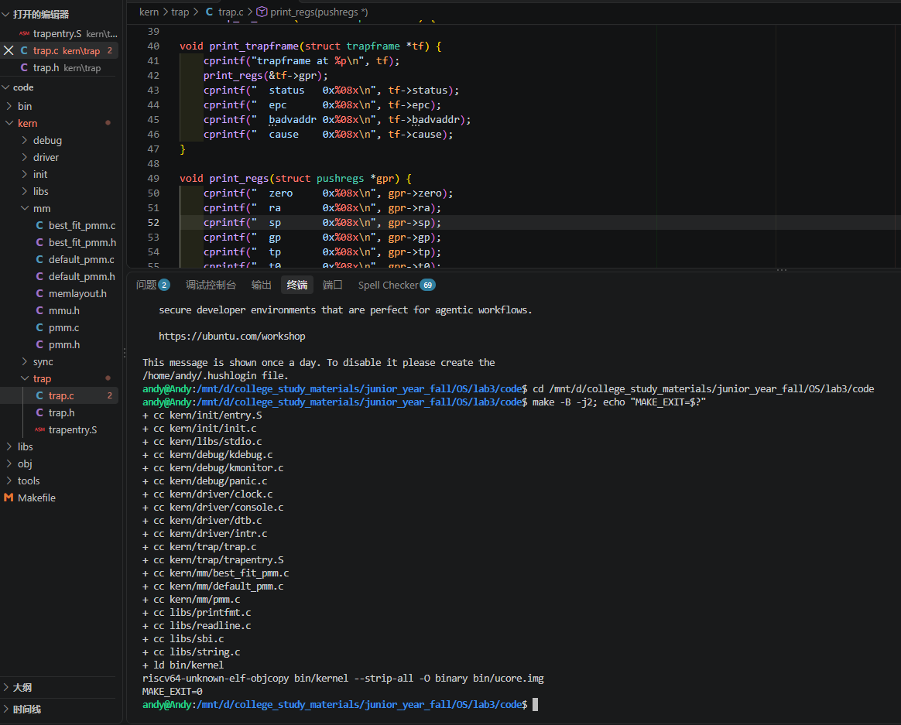
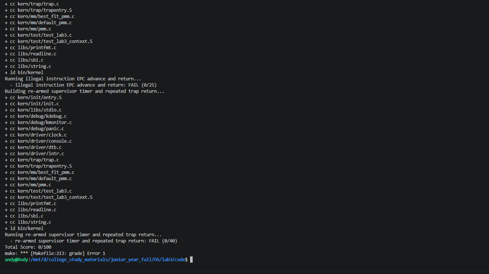
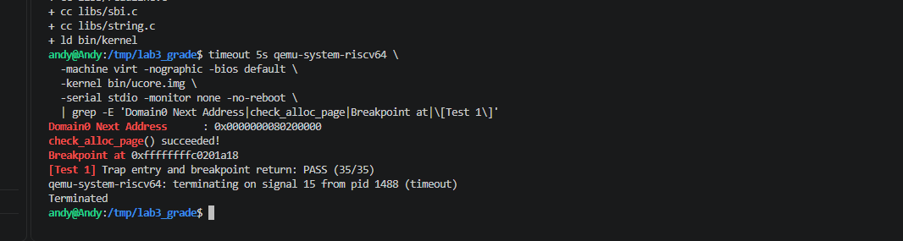
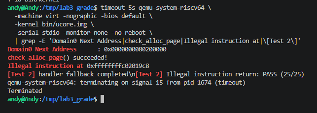
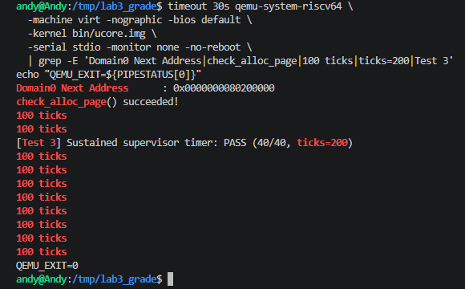
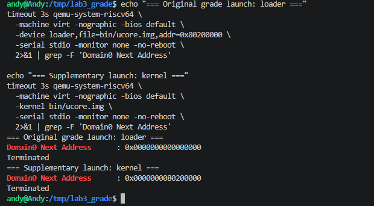

# 操作系统实验报告

## 实验基本信息

| 项目 | 内容 |
|---|---|
| 实验名称 | Lab3:中断与异常 |
| 小组成员 | 张宸笛号—2412565、朱泽帅—2411560、马梓涵—2413902 |
| 实验实现完成日期 | 2026-11-04 |
| 实验报告最终更新日期 | 2026-11-05 |

实现日期只记录两个模块源码已提交齐备的时间，完整实验验收状态以第五章的实际记录为准。

### 小组分工

实验如何分工：

| 成员 | 负责的练习/模块 |
|---|---|
| 张宸笛号—2412565 | 功能模块二：中断与异常处理 |
| 朱泽帅—2411560 | 功能模块一：Trap 上下文恢复与 Trap 入口 |
| 马梓涵—2413902 | 早期 Trap 入口与上下文恢复初版 |

实验报告如何分工：

| 报告部分 | 负责人及内容 |
|---|---|
| 第一至第三章 | 马梓涵—2413902 |
| 第四章 4.1 | 马梓涵—2413902 |
| 第四章 4.2 | 朱泽帅—2411560负责模块资料，Codex 辅助实现记录与报告核对 |
| 第四章 4.3 | 张宸笛号—2412565提供两阶段 Prompt 与模块资料，Codex 辅助扩写 |
| 第五章 | 朱泽帅—2411560、张宸笛号—2412565 |
| 第六章 | 朱泽帅—2411560、张宸笛号—2412565 |

报告初稿见 [44a16ee](https://github.com/iodwad/NKU_OS_2026/commit/44a16ee38b49ed1556ba499d46f77eab55f1f9bd)，后续审计与扩写见 [509e551](https://github.com/iodwad/NKU_OS_2026/commit/509e5514e61fa6022e9a33f75f98cab6f990166c)。表内区分模块资料贡献、AI 辅助整理和待确认的个人执笔归属。

---

## 一、实验目的

本实验在 Lab2 已有的页表和物理内存管理基础上，引入中断与异常处理机制，使内核能够在正常执行被打断后保存现场，完成相应处理，再恢复状态继续运行。具体目标如下：

1. **理解 RISC-V 的 Trap 机制。** 区分中断和异常，了解 M、S、U 三种特权级及中断、异常委托的作用，掌握 `stvec`、`sepc`、`scause`、`stval` 和 `sstatus` 在 Trap 进入与返回过程中的职责。
2. **掌握上下文保存与恢复。** 理解 `struct trapframe` 的布局，以及通用寄存器和相关 CSR 的保存方式；补全与 `SAVE_ALL` 对应的 `RESTORE_ALL`，重点处理栈指针的恢复顺序，保证程序状态不被破坏。
3. **建立汇编入口与 C 处理函数的联系。** 完成 `__alltraps` 中的参数传递和函数调用，理解 RISC-V 调用约定、栈对齐及 `sret` 的作用，形成从 Trap 进入到处理完成后返回的完整流程。
4. **实现基本的中断和异常处理。** 通过时钟中断完成持续计时、统计输出和规定条件下的关机；正确识别非法指令与断点异常，并按指令长度调整返回地址，避免重复触发同一异常。
5. **理解中断保护与验证方法。** 了解修改内存管理等共享数据时保存、关闭和恢复中断状态的必要性；按照四段式结构编写提示词，通过编译、现场检查及运行测试验证实现，区分单个模块通过与完整实验通过。

---

## 二、实验环境

本轮构建与验证在 WSL2 Ubuntu 22.04 运行，使用 RISC-V 交叉编译器 GCC 10.2.0、GNU ld 2.35.1、GNU Make 4.3 和 QEMU 6.2.0，QEMU 默认固件为 OpenSBI 0.9。基线为团队 `lab3` 提交 `7d9948ec8e284856ee2689489cec782c09b6005b`。版本与命令见 [环境记录](../evidence/full-validation-20261105-7d9948e/environment.json) 和 [执行记录](../evidence/full-validation-20261105-7d9948e/commands.json)。

### AI 工具使用情况

| 成员 | AI 编程工具 | 底层模型 | 备注 |
|---|---|---|---|
| 张宸笛号—2412565 | 待成员确认 | 未核实 | 已提供模块二 RELY 收集及四段式 Prompt，具体工具待确认 |
| 朱泽帅—2411560 | Codex（可核实会话） | gpt-6.1-sol（会话记录） | 模块一、SPEC、测试分析及报告整理 |
| 马梓涵—2413902 | 待成员确认 | 未核实 | Lab3 工具、模型及具体使用记录待补充 |

已核实的 Codex 会话记录客户端为 Codex Desktop，来源字段为 vscode。VS Code 具体使用方式及 ChatGPT 单独使用情况仍待朱泽帅确认，模型填写仅对应已核实会话。另两位成员的 Lab2 工具表不直接沿用为 Lab3 使用记录。

---

## 三、实验整体逻辑分析

### 3.1 本章节的逻辑主线

我们对本次实验的理解是：**让内核在程序被打断时，能够先保存当前状态，处理发生的事情，再恢复状态继续运行。** Lab2 解决了内存管理的问题，Lab3 则在此基础上加入中断和异常处理，使内核能够响应时钟等事件。

在 RISC-V 中，中断和异常统称为 Trap。中断是异步发生的，比如定时器到点，与当前执行的指令没有直接关系；异常由当前指令触发，比如非法指令和断点。在本实验中，它们都会先进入统一入口，再根据原因分别处理。

处理 Trap 时，硬件会先记录返回地址、原因和相关状态，然后跳到 `stvec` 指定的位置。但硬件不会自动把全部通用寄存器保存到栈里，所以还需要汇编代码保存这些值，在内核栈上形成一份 `struct trapframe`。我们把它理解为程序暂停时的一份现场记录，后面的 C 函数可以通过它判断发生了什么，恢复代码也可以根据它把程序状态还原。

实验中的两个模块正好对应这一流程的不同部分。模块一负责保存现场后的参数传递和处理后的现场恢复，模块二负责具体处理中断和异常。它们共用同一份现场，因此保存时放在哪个位置，处理和恢复时就必须从对应位置读取，不能各用一套布局。

相关代码的分工如下：

| 部分 | 关键文件/接口 | 主要作用 |
|---|---|---|
| 启动与初始化 | `kern/init/entry.S`、`kern/init/init.c`、`pmm_init()` | 准备内核运行环境，接入 Lab2 的内存管理代码 |
| 设置 Trap 入口 | `idt_init()`、`stvec` | 告诉 CPU 发生交给 S 模式处理的 Trap 后跳到哪里 |
| 保存与恢复现场 | `kern/trap/trapentry.S`、`struct trapframe` | 保存寄存器和相关状态，处理结束后恢复并返回 |
| 判断和处理事件 | `trap()`、`trap_dispatch()`、两个处理函数 | 区分中断与异常，执行相应处理 |
| 设置时钟 | `kern/driver/clock.c`、`clock_set_next_event()`、SBI | 设置下一次时钟事件，支持持续计时 |
| 保护关键操作 | `kern/driver/intr.c`、`kern/sync/sync.h` | 暂时关闭本核中断，操作结束后恢复原来的中断状态 |

把这些代码连起来，可以得到下面的主要流程：

```text
初始化：
kern_init()
  ├─ 清零 BSS、解析设备树、初始化控制台
  ├─ idt_init()：设置统一 Trap 入口
  ├─ pmm_init()：初始化物理内存管理
  ├─ clock_init()：允许时钟中断，设置第一次时钟事件
  └─ intr_enable()：打开 S 模式全局中断开关

一次交给 S 模式处理的 Trap：
硬件记录返回地址、原因和状态，跳转到 __alltraps
  → SAVE_ALL：在内核栈上保存现场
  → trap(tf)
  → trap_dispatch(tf)
      ├─ interrupt_handler(tf)：处理中断
      └─ exception_handler(tf)：处理异常
  → C 函数返回，进入 __trapret
  → RESTORE_ALL：恢复现场
  → sret：返回继续执行
```

初始化部分列出了主要步骤，框架实际上在内存初始化前后都调用了 `idt_init()`。这里重要的是先把入口和处理环境准备好，再打开中断。我们还需要区分两次“返回”：`trap()` 返回只是从 C 函数回到汇编代码，之后还要恢复现场，再通过 `sret` 结束这次 Trap。`sret` 根据保存的状态决定返回到 S 模式还是 U 模式，并不总是返回用户态。

### 3.2 功能的逐步实现

1. **先接入 Lab2 的代码。** Lab3 仍然需要之前完成的物理内存初始化和 Best-Fit，所以要把对应实现补到框架标有 Lab2 的位置。迁移时不能直接用旧文件覆盖新文件，还要保留 Lab3 新增的中断保护代码，为后续处理打好基础。

2. **设置入口，弄清楚硬件已经做了什么。** `idt_init()` 把 `__alltraps` 的地址写入 `stvec`，采用 Direct 模式，让相关中断和异常先到同一个入口。发生 Trap 时，`sepc` 记录返回位置，`scause` 记录原因，`stval` 提供附加信息，`sstatus` 保存与返回有关的状态。分清这些寄存器的作用，才能理解后面哪些信息需要保存、如何恢复。

3. **完成模块一，让汇编和 C 函数接上。** `SAVE_ALL` 已经按固定顺序保存 x0～x31 和四个 CSR 的值，RV64 下现场共占 288 字节。`__alltraps` 需要按照调用约定把现场地址传给 `trap()`，并保持栈对齐。C 函数返回后，`RESTORE_ALL` 按对应位置恢复寄存器、`sstatus` 和 `sepc`，最后恢复 `sp`，再由 `sret` 返回。我们认为这里最需要注意的是 `sp`：它既是要恢复的寄存器，又是读取现场时使用的地址，必须等其他内容读取完成后再恢复。C 函数如果合法修改了现场，也要使用修改后的值返回。

4. **完成模块二，分别处理中断和异常。** `trap_dispatch()` 根据 `scause` 的最高位判断类别，再调用相应处理函数。时钟中断要设置下一次事件、增加 `ticks`，定期输出统计信息，达到规定条件后关机。非法指令和断点异常则要输出信息，并按指令长度更新 `tf->epc`。如果返回地址没有调整，CPU 可能再次执行同一条异常指令，反复进入处理函数。其他未要求实现恢复的异常可以打印现场辅助排查，但打印现场本身并不代表问题已经解决。

5. **理解时钟为什么能持续触发，以及关键操作为什么要关中断。** SBI 的定时器接口一次设置一个事件，所以每次处理中断时还要安排下一次，才能持续计时。允许时钟这一类中断和打开 S 模式全局中断开关是两件事，都需要正确设置。修改空闲链表等数据时，要先保存原来的中断状态，关闭本核中断，完成后再恢复原状态。如果之前中断本来就是关闭的，就不能在操作结束后直接打开。这里保护的是本核中断可能带来的干扰，多核共享数据还需要其他同步措施。

6. **写清提示词，再检查整条处理流程。** 提示词按 `[PROMPT]`、`[RELY]`、`[GUARANTEE]`、`[SPECIFICATION]` 四部分组织，说明改哪里、能用什么、要完成哪些接口，以及不同情况下应该有什么结果。验证时除了看代码能否编译，还要检查现场地址是否传对、寄存器和栈指针是否恢复、异常能否正确跳过，以及时钟中断能否连续发生并返回。只有保存、处理、恢复和继续执行都正确，才能说明整个流程正常；单独一个文件编译成功还不够。

---

## 四、实验内容与实现

本章沿用 Lab2 报告中“功能与接口理解—SPEC—Prompt—实现核对—问题记录”的组织方式。模块二按当前源码说明处理流程，运行结果见第五章的验证范围。

### 4.1 Lab2 前置功能迁移：物理内存初始化与 Best-Fit

#### 4.1.1 迁移目标与接口关系

Lab3 依赖 Lab2 的物理内存管理基础。课程骨架在 `kern/mm/pmm.c` 和 `kern/mm/best_fit_pmm.c` 保留了 `lab2` 填写位置，而 `pmm_init()` 仍依赖 `page_init()`，物理页分配则依赖 `pmm_manager` 的回调。迁移使用的来源为团队仓库 `lab2` 分支提交 `ea3300cd028a0af8ddea475b093a2a8f9c7f10a8`，不是从已有 Lab3 工作分支复制其他同学的 Trap 实现。

课程骨架下载失败后，工程采用团队仓库的导入提交 `d0bb450d845bfd33b9e4584855d9194d93a9ab5c`。下载错误及来源见 [来源记录](../evidence/source.json)，该导入版本与课程 ZIP 的一致性未经核验。迁移时使用的 [原始 Prompt](./prompt.md) 已完整保留。

迁移范围如下：

| 目标文件 | 迁移内容 | 保留的 Lab3 原有内容 |
|---|---|---|
| [`kern/mm/pmm.c`](../code/kern/mm/pmm.c) | `page_init()`；将 `pmm_manager` 绑定到已完成的 Best-Fit | `alloc_pages()`、`free_pages()`、`nr_free_pages()` 中的中断状态保存与恢复 |
| [`kern/mm/best_fit_pmm.c`](../code/kern/mm/best_fit_pmm.c) | `free_area`、`free_list/nr_free`、五个核心函数与 `best_fit_pmm_manager` | 骨架已提供的 `basic_check()`、`best_fit_check()` |

`page_init()` 使用 DTB 提供的物理内存范围，在排除内核镜像与页描述符数组后登记可用整页。Best-Fit 则在足够大的空闲块中选取最小者，分配时按需拆分，释放时尝试合并相邻空闲块。两者分别负责可分配范围的建立和空闲块的选取，不能相互代替。

#### 4.1.2 迁移过程中的兼容性处理

Lab2 与 Lab3 的部分映射常量不同：旧 `page_init()` 使用的 `KERNEL_BEGIN_PADDR` 和 `PHYSICAL_MEMORY_END` 未在 Lab3 相应头文件中定义。本次没有整体覆盖 Lab3 的 `memlayout.h`，而是依据现有的 `KERNBASE`、`KERNTOP`、`PHYSICAL_MEMORY_OFFSET` 在 `page_init()` 内计算等价物理边界。当前映射下分别为 `0x80200000` 和 `0x88000000`。DTB 范围验证、地址溢出检查、页描述符容量检查以及页面对齐逻辑均保留。

Lab3 已为物理页分配接口增加 `local_intr_save/local_intr_restore`，因此不能把 Lab2 的 `pmm.c` 整文件覆盖过去，否则会丢失本实验新增的中断保护。Best-Fit 中也只迁移缺失的算法部分，避免重复定义课程检查函数。相关前后差异见 [`evidence/migration.patch`](../evidence/migration.patch)。

#### 4.1.3 迁移核对与验证边界

迁移后的 `pmm.c` 与 `best_fit_pmm.c` 均经过独立强制编译，退出码为 0；原始记录见 [`make-migrated-forced.log`](../evidence/make-migrated-forced.log)。这一结果只能说明迁移代码在当前工具链与头文件下能够编译，**不能据此宣称 Lab3 已通过物理内存管理的运行时检查**。迁移阶段的完整构建曾在 `trap.c` 处失败，见第 5.4 节。

### 4.2 功能模块一：Trap 上下文恢复与 Trap 入口

**负责人：2411560—朱泽帅**

#### 4.2.1 功能与接口理解

本模块在 [`kern/trap/trapentry.S`](../code/kern/trap/trapentry.S) 中补全 `RESTORE_ALL` 与 `__alltraps`。课程已经提供 `SAVE_ALL`、`__trapret` 和 `sret`，并规定不能修改 `struct trapframe` 或 `void trap(struct trapframe *tf)` 的签名。

我将本模块理解为汇编与 C 之间的状态交接：CPU 进入 S-mode Trap 后，`SAVE_ALL` 在当前可用内核栈上保存现场；`__alltraps` 以指针形式将现场传给 `trap()`；处理函数正常返回后，`RESTORE_ALL` 从同一个现场恢复整数寄存器及返回所需的 CSR；最后由 `sret` 完成 Trap 返回。`trap()` 的普通 `ret` 仅返回汇编调用位置，不能代替 `sret`。

#### 4.2.2 Trap frame 布局与 SAVE_ALL 的对应关系

RV64 下 `REGBYTES=8`，`SAVE_ALL` 为现场分配 `36×8=288` 字节。`struct pushregs` 对应 x0～x31 的 32 个槽位，之后是 `status`、`epc`、`badvaddr` 和 `cause` 四个字段。核心偏移为：

| 内容 | 相对当前 `sp` 的偏移 | 作用 |
|---|---:|---|
| `gpr.ra`（x1） | 8 | 保留被中断代码原来的普通函数返回地址 |
| `gpr.sp`（x2） | 16 | 保留 Trap 前的栈指针 |
| `gpr.a0`（x10） | 80 | 保留原始第一个参数寄存器 |
| `status`（`sstatus`） | 256 | 为 `sret` 提供相关特权与中断状态 |
| `epc`（`sepc`） | 264 | 为 `sret` 提供返回地址 |
| `badvaddr`（`stval`） | 272 | 保存部分异常的附加信息 |
| `cause`（`scause`） | 280 | 供 C 处理函数判断 Trap 原因 |

`SAVE_ALL` 不能像保存其他通用寄存器那样直接保存 x2，因为划出 288 字节后 `sp` 已经改变。它先将原始 `sp` 写入 `sscratch`，再经由已保存原值的 `s0` 转存到第 2 个槽位。因此 `RESTORE_ALL` 必须按实际布局读取原始 x2，不能把当前 Trap frame 的地址当成原程序的 `sp`。

#### 4.2.3 RESTORE_ALL：上下文恢复的实现

恢复过程先从第 32、33 号槽位取出当前 Trap frame 中的 `status` 和 `epc`，写回 `sstatus`、`sepc`；再按保存偏移恢复 x1、x3～x31；最后才恢复 x2。其核心逻辑可由以下片段概括（完整实现见源码）：

```asm
#lab3 function1 2411560
LOAD s0, 32*REGBYTES(sp)
LOAD s1, 33*REGBYTES(sp)
csrw sstatus, s0
csrw sepc, s1
# ...按原槽位恢复其他通用寄存器...
LOAD x2, 2*REGBYTES(sp)
```

此处 `s0`、`s1` 是恢复 CSR 时的临时寄存器；它们的原始值此前也保存在 Trap frame，随后通过对应的通用寄存器加载恢复。`sp` 必须最后恢复，因为前面的加载都需要用当前 `sp` 定位 Trap frame。`x0` 恒为零，不需要恢复；`scause` 和 `stval` 用于处理与诊断，不是本次 `sret` 的返回输入，因此没有在此处写回。恢复 `sepc` 时读取的是 Trap frame 中**当前**的 `epc`，以便兼容 C 处理函数对返回地址的合法调整。

#### 4.2.4 __alltraps：汇编入口与 C 函数调用

`__alltraps` 在现有 `SAVE_ALL` 之后，将当前 `sp` 指向的 Trap frame 地址放入 `a0`，随后调用 C 语言的 `trap()`：

```asm
__alltraps:
    SAVE_ALL
    #lab3 function1 2411560
    move a0, sp
    call trap
```

RISC-V 调用约定使用 `a0` 传递第一个指针参数，因此传入的是 `struct trapframe *`，并非复制整个 288 字节结构体。原始 `a0` 和 `ra` 已在 `SAVE_ALL` 中保存，允许调用代码暂时使用这些寄存器。若进入 Trap 前的内核栈按 16 字节对齐，减去 288 字节仍保持对齐。`trap()` 正常返回后，控制流顺序进入 `__trapret`，由恢复宏和 `sret` 完成后续工作。

该入口直接使用当前栈，没有实现从 U-mode 栈切换到独立内核栈；此处不能扩展宣称支持完整的用户态 Trap 入口或任意嵌套 Trap。

#### 4.2.5 SPEC 的编写

本题的 SPEC 首先来自已有 `SAVE_ALL`、`trap.h` 与 RISC-V ABI，而不是从预先选定的汇编语句倒推。两项功能虽然各有职责，却共同依赖同一 Trap frame，因此在同一份规格中定义了输入条件、成功后的状态及关键时序约束。

| 规格对象 | Pre-Condition | Post-Condition / Case | 关键 Requirements |
|---|---|---|---|
| `RESTORE_ALL` | `sp` 指向有效 Trap frame，`trap()` 已正常返回 | 恢复原整数现场及 `sstatus`、`sepc`；当处理函数修改 `tf->epc` 时使用更新值 | 偏移与 `SAVE_ALL` 一致，临时寄存器最终恢复，x2 最后恢复，不重复执行 `sret` |
| `__alltraps` | 已进入入口，有效内核栈可供 `SAVE_ALL` 使用 | 保存现场并把其地址传给 `trap(tf)`；正常返回后进入 `__trapret` | 首个参数使用 `a0`，维持 16 字节对齐，保护原始 `a0`、`ra`，不改变固定接口 |

在规格中将正常返回与处理函数修改 `epc` 的情况分开，是为了防止实现只恢复 Trap 发生时的旧地址；特别明确 `sp` 的恢复顺序，是为了避免在还需要读取 Trap frame 时破坏内存基地址。完整的 Pre-Condition、Post-Condition、Case 与 Requirements 见 [功能模块一原始 Prompt](./prompt.md)。

#### 4.2.6 Prompt 的编写与 AI 协作过程

本题按照课程要求使用同一份四段式提示词，完整原文保存在 [功能模块一原始 Prompt](./prompt.md)。`[PROMPT]` 限定 `trapentry.S` 中两个 `lab3 function1` 标记位置，要求直接修改文件并保留其他代码；`[RELY]` 提供真实 `LOAD/STORE/REGBYTES` 宏、`SAVE_ALL` 的特殊保存关系、`trapframe` 字段和 `trap()` 接口；`[GUARANTEE]` 只列 `RESTORE_ALL` 和 `__alltraps` 两个交付功能；`[SPECIFICATION]` 规定 CSR、通用寄存器和 `sp` 的恢复状态、传参、栈对齐及不得修改的边界。

选择以**一个模块、一份 Prompt**完成两处汇编填空，是因为参数传递与恢复共享一个现场布局，单独生成其中一个功能可能遗漏对另一个功能的依赖。AI 生成后没有直接将“编译成功”视为闭环正确，而是保留源文件前后差异、静态核对、汇编对象和反汇编输出，核对过程见 [4.2.7](#427-ai-生成及核验过程中实际遇到的问题)，汇编与发布证据见 [5.3](#53-模块一汇编编译反汇编与发布核对)。

#### 4.2.7 AI 生成及核验过程中实际遇到的问题

本次没有证据表明生成的 `RESTORE_ALL` 存在已确认的语义错误。实际记录的问题需要按性质区分：

1. **原始骨架未填写。** 首次对空白骨架执行静态检查为 9/16，通过项不涉及尚缺失的两项功能。这说明任务尚未实现，不应描述成 AI 生成后的 Bug。填入模块一代码后，原版本静态检查达到 16/16。
2. **验证命令的退出码保存错误。** 首次 shell 包装脚本出现 `exit: : numeric argument required`，属于退出码变量传递问题。随后改用 Python 的 `subprocess.returncode` 保存实际子进程退出状态，不需要修改内核汇编。
3. **发布版本的测试脚本与指令写法不匹配。** 最初检查脚本匹配 `jal trap`，后续发布代码采用 `call trap`，使历史脚本出现 15/16。重新汇编退出码为 0，反汇编中确认 `R_RISCV_CALL trap` 重定位；对当前调用形式的独立检查通过。该不匹配来自验证脚本对指令写法的过度限定，不能简单认定为 Trap 入口功能错误。
4. **模块一实现阶段的完整内核构建失败。** 当时的 `trap.c` 尚未定义 `interrupt_handler` 和 `exception_handler`，隐式声明在 `-Werror` 下导致 `make` 退出码为 2。该日志对应模块二处理函数提交前的版本。

原始日志分别见 [`static-before.log`](../evidence/module1/static-before.log)、[`static-after.log`](../evidence/module1/static-after.log)、[`publication-checks.json`](https://github.com/iodwad/NKU_OS_2026/blob/9f292ecd0f239d3d44fe05f60156671f964f750f/lab3/evidence/module1/publication-checks.json) 和 [`kernel-build.log`](../evidence/module1/kernel-build.log)。

### 4.3 功能模块二：中断与异常处理

**负责人：2412565—张宸笛号**

#### 4.3.1 功能与接口理解

`trap(tf)` 接收汇编入口保存的现场，`trap_dispatch()` 将 `cause` 解释为有符号整数，按 RV64 的第 63 位将中断和异常交给不同函数。[`trap.c`](../code/kern/trap/trap.c) 中的 `interrupt_handler(tf)` 负责定时器和中断诊断，`exception_handler(tf)` 负责实验要求的异常。`trap_instruction_length(epc)` 是内部辅助函数。模块二改写 `tf->epc` 后，模块一从同一帧恢复 `sepc`，`sret` 才会使用新的地址。

#### 4.3.2 中断处理机制

`interrupt_handler()` 清除 `cause` 的第 63 位，再以原因编号分类。S 模式时钟中断的编号为 `IRQ_S_TIMER=5`。处理函数先调用 `clock_set_next_event()`，通过 SBI 将下一事件设置为 `rdtime + timebase`，再递增 `ticks`。`TICK_NUM` 为 100，每达到一个正整数倍就调用已有的 `print_ticks()`。

`SHUTDOWN_AFTER=10` 来自正式 Prompt 的暂定约定，源码也保留了暂定注释。它统计的是 `print_ticks()` 的调用次数，常规配置下对应第 1000 个 tick，随后调用 `sbi_shutdown()`。官方持续时钟用例要求到达 200 ticks，并未把 10 次统计规定为评分条件。原有 `DEBUG_GRADE` 条件分支仍由框架控制。

其他已知编号按软件、时钟、外部中断等名称输出，其中 S 模式软件中断输出 `Supervisor software interrupt`。未知编号输出原因值与 Trap frame。两类分支不重新设置时钟、不累加 `ticks`。打印名称仅提供诊断，设备应答、清除待决位与中断控制器处理需要相应驱动。

#### 4.3.3 异常处理机制

非法指令和断点分别打印 `Illegal instruction at`、`Breakpoint at` 与触发地址。辅助函数要求 `epc` 按半字对齐，且首半字落在 `[KERNBASE, etext)`。读取首半字后，在本实验的 16/32 位编码范围内，低两位为 `11` 时按 4 字节处理，否则按 2 字节处理。完整指令仍须在内核文本范围内才会推进 `tf->epc`。这一区别使普通 `EBREAK`、压缩 `C.EBREAK` 和测试中的 4 字节非法指令不必使用同一固定偏移。

地址不满足检查时，代码打印 Trap frame 并保留原 EPC。其他异常直接打印现场并返回。若同一条指令或取指条件保持不变，`sret` 后可能再次触发相同异常。这里的范围检查依赖当前内核文本映射可读，没有通用的用户地址或页表探测恢复机制。

#### 4.3.4 SPEC 的编写

两项规格的共同前置条件是 `tf` 指向有效 Trap frame。中断还依赖已初始化的时钟与有效的 `cause`。异常依赖保存的 `epc` 和异常编号。后置条件落在可核对的状态变化上，包括是否安排下次时钟、是否计数、是否更新 EPC，以及哪些字段保持原值。

| 接口与条件 | Case 1 | Case 2 | Case 3 | Requirements 与实现对应 |
|---|---|---|---|---|
| `interrupt_handler()` | S 模式时钟重新安排事件并计数，周期输出，按真实统计次数检查关机 | 其他已知类型按编号打印，不计时 | 未知编号打印原因和现场，保留 EPC 与计数 | 清除最高位后比较编号，也允许课程测试直接传入 15。计时路径复用框架接口，200 ticks 由测试读取真实计数 |
| `exception_handler()` | 非法指令输出地址，按编码和边界推进 EPC | 断点同样按 2 或 4 字节推进 EPC | 其余异常仅输出 Trap frame，保留现场 | 使用现有异常常量和固定输出子串。读指令前检查地址，只有可判定长度时才更新 `tf->epc` |

关机阈值、诊断输出与返回行为分开写入约束，可避免通过硬编码测试字符串替代实际中断处理。把诊断和恢复分开，也能明确打印现场后是否仍可能返回到同一异常地址。

#### 4.3.5 Prompt 的编写与 AI 协作过程

张宸笛号提供的附件包含两阶段文本。第一阶段仅收集可直接用于实现的 RELY，包括真实宏、Trap frame、已有函数和评分输出，要求只读项目。第二阶段以四段式限制修改区、接口和行为，覆盖三类中断和三类异常，并规定真实编译及测试。两阶段按原顺序收录在 [原始 Prompt](./prompt.md)。现有附件可以确认这两份输入的内容，未提供逐轮模型回复或调试对话。

#### 4.3.6 实现过程与实际问题

团队提交 `0de568894a7787cca404ca1b524b23febc4e79b5` 增加了 `interrupt_handler()`、`exception_handler()`、`trap_instruction_length()` 及内部阈值，原有分发和返回接口保持不变。本轮将遗留的模块二占位注释改为学号 `2412565`。模块一实现期的完整内核曾因两个函数未定义而编译失败。当前完整源码已通过构建，缺少队友实现期间单独的编译失败与修复日志。

本轮原版评分确实出现三组失败。启动诊断表明默认 OpenSBI 交接地址为 `0x0`，三个用例没有进入内核测试。使用相同测试源和镜像构建方式，将启动诊断参数改为 `-kernel` 后重新取得用例输出，详见第五章。没有把补充运行计入正式评分。`trap()` 上方的 `iret` 是历史注释，实际返回指令为 `sret`。

#### 4.3.7 验证边界及实现局限

断点、非法指令和持续时钟用例由真实 QEMU Trap 触发。回退用例则构造 `tf` 后直接调用处理函数，覆盖软件中断分类、未知中断和未知异常的诊断输出，未经过硬件入口和 `sret`。Context 测试比较选定的整数寄存器，不能扩展为所有 GPR 或浮点、向量状态的验证。

当前实现依赖可读的内核文本、有效内核栈与已有 SBI 定时器。超出文本范围的 EPC、未知异常以及持续挂起的设备中断均没有通用恢复策略。已打印异常或中断名称只能证明到达了相应分支。

---

## 五、测试与验证

本章区分早期编译与静态验证、当前完整内核构建、原版评分和补充启动诊断。评分分数以原版脚本输出为准。

### 5.1 Lab2 迁移源文件编译

迁移后的 `kern/mm/pmm.c` 与 `kern/mm/best_fit_pmm.c` 已通过强制重新编译，退出码为 0。该检查用于确认 Lab2 功能迁移没有因头文件或地址常量差异造成即时编译错误。证据为 [`make-migrated-forced.log`](../evidence/make-migrated-forced.log) 及对应的 `.exit` 文件。它不是迁移后的内存分配运行测试，也不继承 Lab2 既往 `make grade` 分数作为 Lab3 的新结果。

### 5.2 模块一静态检查与 Trap frame 布局验证

模块一实现阶段以课程骨架为基准，验证了保存与恢复槽位、`sstatus/sepc` 位置、x2 最后恢复、参数传递与修改范围。原版本静态检查 16/16；目标文件检查 8/8。使用 RISC-V 交叉编译器编译专门的 `layout_check.c`，通过 32 个 GPR、4 个 CSR 字段偏移和结构体大小/对齐的编译期检查，退出码为 0。相关记录见 [`static-after.log`](../evidence/module1/static-after.log)、[`object-check.log`](../evidence/module1/object-check.log)、[`layout-compile.log`](../evidence/module1/layout-compile.log)。这些属于静态及编译期证据，不能替代真实 Trap 执行后的寄存器值比较。

### 5.3 模块一汇编编译、反汇编与发布核对

使用工程 Makefile 的编译参数单独构建 `trapentry.S`，实际汇编退出码为 0。`objdump/readelf` 证据显示：保存的 CSR 与 GPR 按预期槽位恢复，最后恢复 `sp`；入口将当前 Trap frame 地址置入 `a0`。发布版本采用 `call trap`，重新汇编退出码仍为 0；反汇编检查到 `R_RISCV_CALL trap` 重定位，说明对象文件保留了对 C 语言 `trap` 符号的正常调用关系。

发布后 [`publication-checks.json`](https://github.com/iodwad/NKU_OS_2026/blob/9f292ecd0f239d3d44fe05f60156671f964f750f/lab3/evidence/module1/publication-checks.json) 记录历史脚本 15/16，原因是原脚本固定匹配 `jal trap`，而当前实现为 `call trap`；独立调用检查通过。此处应把“核验脚本的字面匹配失败”和“汇编功能检查失败”分开描述。相关证据为 [`publication-assemble.log`](https://github.com/iodwad/NKU_OS_2026/blob/9f292ecd0f239d3d44fe05f60156671f964f750f/lab3/evidence/module1/publication-assemble.log)、[`publication-objdump.log`](https://github.com/iodwad/NKU_OS_2026/blob/9f292ecd0f239d3d44fe05f60156671f964f750f/lab3/evidence/module1/publication-objdump.log)。

### 5.4 完整内核构建

模块二提交前，实际执行完整内核构建时，`make` 退出码为 2，编译停在 `kern/trap/trap.c`，未进入链接。主要错误为：

```text
trap.c:89: implicit declaration of function 'interrupt_handler'
trap.c:92: implicit declaration of function 'exception_handler'
cc1: all warnings being treated as errors
```

该日志记录了两个处理函数尚未实现时的失败。当前源码已包含两者，下面记录相同工具链下对最新提交的构建。历史输出及退出状态见 [`kernel-build.log`](../evidence/module1/kernel-build.log) 和 [`kernel-build.exit`](../evidence/module1/kernel-build.exit)。

在独立副本执行 `make -j2`，退出码为 **0**。输出包含 `+ ld bin/kernel` 及生成 `bin/ucore.img` 的 `objcopy` 命令。原始证据见 [标准输出](../evidence/full-validation-20261105-7d9948e/make.stdout.log)、[标准错误](../evidence/full-validation-20261105-7d9948e/make.stderr.log) 和 [退出码](../evidence/full-validation-20261105-7d9948e/make.exit)。运行验证以该提交的代码为基准，审阅版随后仅补了模块二学号注释。

**本地同步版本的重新构建截图。** 在同步远程功能代码并保留原有中文注释后，另执行 `make -B -j2; echo "MAKE_EXIT=$?"` 强制编译。截图中可见完整编译序列、`+ ld bin/kernel`、`riscv64-unknown-elf-objcopy ... bin/ucore.img`，以及 `MAKE_EXIT=0`。这与前述隔离环境的编译成功记录相互印证，但它本身只证明构建成功，不替代 Trap 的动态运行验证。



*图1：同步后的本地 Lab3 在 WSL 中强制重新构建。内核完成链接并生成 `ucore.img`，命令返回 `MAKE_EXIT=0`。*

### 5.5 原版课程评分与补充运行

#### 5.5.1 原版 `make grade`：评分结果及其含义

按课程原有流程执行 `make grade`。评分脚本通过 `GRADE_TMP` 创建注入测试副本，为三组用例分别清理和编译镜像，再使用 `-device loader,file=bin/ucore.img,addr=0x80200000` 启动 QEMU。脚本与测试断言未修改。三个用例均未检出要求的通过标记，官方流程实际输出 **`Total Score: 0/100`**，顶层 `make` 退出码为 **2**。原始证据见 [评分标准输出](../evidence/full-validation-20261105-7d9948e/grade.stdout.log)、[标准错误](../evidence/full-validation-20261105-7d9948e/grade.stderr.log)及[退出码](../evidence/full-validation-20261105-7d9948e/grade.exit)。



*图2：原版 `make grade` 的终端输出末段，可见非法指令测试 `0/25`、时钟测试 `0/40` 及最终 `Total Score: 0/100`。截图未覆盖首项 `0/35`，该项结果以完整评分日志为准。*

这张图**不能直接证明三个处理模块的逻辑均失败**。结合后述串口及启动诊断，原评分运行在本机 QEMU 6.2/OpenSBI 0.9 环境下尚未进入内核测试入口。`0/100` 是原版评分的真实输出，但不是三个用例被完整执行后的功能性零分结论。

#### 5.5.2 相同测试源的 `-kernel` 补充运行

为区分启动交接与功能实现，保留课程注入的测试源和相应 `GRADE_LAB3_*` 宏，分别重新编译三组镜像，改用 `qemu-system-riscv64 -machine virt -nographic -bios default -kernel bin/ucore.img -serial stdio -monitor none -no-reboot` 运行。以下三组均从内核实际输出中获得相应通过标记；**这些标记属于补充运行，不作为原版 `make grade` 得分**。

| 用例（原版权重） | 原版 `make grade` | 本次 `-kernel` 补充运行 | 对应原始证据 |
|---|---:|---|---|
| Trap 上下文保存、断点及返回（35） | FAIL，0/35 | 触发 `Breakpoint at`，输出 `[Test 1] ... PASS (35/35)` | [串口日志](../evidence/full-validation-20261105-7d9948e/supplementary-context-run.stdout.log) |
| 非法指令与回退处理（25） | FAIL，0/25 | 输出非法指令地址、处理回退分支并出现 `[Test 2] ... PASS (25/25)` | [串口日志](../evidence/full-validation-20261105-7d9948e/supplementary-illegal-run.stdout.log) |
| Supervisor Timer 持续中断（40） | FAIL，0/40 | 到达 `ticks=200` 并输出 `[Test 3] ... PASS (40/40)`，最终退出码为 0 | [串口日志](../evidence/full-validation-20261105-7d9948e/supplementary-timer-run.stdout.log) |

**Trap 上下文与断点。** 第一组启动地址为 `0x80200000`，先输出 `check_alloc_page() succeeded!`，随后发生 `Breakpoint at 0xffffffffc0201a18`，最终输出 `[Test 1] Trap entry and breakpoint return: PASS (35/35)`。这说明测试中的断点 Trap 能进入处理路径、调整返回位置并到达寄存器比对后的通过分支；并不意味着全部体系结构寄存器都已穷举验证。



*图3：使用 `-kernel` 启动的 Context 用例，出现断点地址及 `PASS (35/35)`。末尾的 `Terminated` 来自 `timeout 5s` 主动终止持续运行的 QEMU，不表示测试断言失败。*

**非法指令与回退分支。** 第二组触发 `Illegal instruction at 0xffffffffc02019c8`，并输出 `[Test 2] Illegal instruction return: PASS (25/25)`。该场景验证 4 字节非法指令后可以继续执行，课程注入代码还直接构造 Trap frame 调用部分回退处理函数；不能据此推断所有未知异常均可恢复。截图中 `handler fallback completed
[Test 2]` 之间的字面量 `
` 来自测试代码本身的输出写法，而非截图拼接。



*图4：使用 `-kernel` 启动的非法指令用例，显示触发地址及 `PASS (25/25)`。本次运行同样被 `timeout 5s` 终止，测试通过标记已在超时前出现。*

**持续时钟。** 第三组显示周期性的 `100 ticks` 输出，并到达 `[Test 3] Sustained supervisor timer: PASS (40/40, ticks=200)`。计数到 200 之后中断继续运行，累计十次周期输出后 QEMU 以 `QEMU_EXIT=0` 退出，与当前实现 `SHUTDOWN_AFTER=10` 和 SBI 关机调用的预期一致。200 tick 是测试检查点，十次输出后的关机阈值是当前代码采用的暂定设计值，不应视为课程明确规定的阈值。



*图5：`-kernel` 时钟补充测试显示达到 200 ticks、测试通过标记、多次 `100 ticks` 及最终 `QEMU_EXIT=0`，支持持续定时与正常关机的判断。*

本轮截图来自与最新远程功能实现同步、保留个人注释的本地工作区。先前隔离审计中三组运行的具体命令、退出码与关键输出也保存在 [补充运行记录](../evidence/full-validation-20261105-7d9948e/supplementary-results.json)。前两组在通过标记出现后继续运行，由 `timeout` 终止；时钟组结束于正常关机。这些退出方式必须与测试标记分别解释。

#### 5.5.3 OpenSBI 启动交接对比与失败归因

使用相同的 `bin/ucore.img`，在本机 QEMU/OpenSBI 下对比两种命令行：`-device loader,file=bin/ucore.img,addr=0x80200000` 将镜像放置到指定内存位置，但本次环境下固件报告 `Domain0 Next Address = 0x0`；`-kernel bin/ucore.img` 则使固件报告 `Domain0 Next Address = 0x80200000`。前者未进入内核测试，后者能够继续输出内存初始化、异常和时钟测试结果。原评分的 QEMU/GDB 诊断见 [启动串口](../evidence/full-validation-20261105-7d9948e/qemu-timer.serial.log)、[QEMU 追踪](../evidence/full-validation-20261105-7d9948e/diagnostic-qemu-trace.log)及[GDB 记录](../evidence/full-validation-20261105-7d9948e/diagnostic-gdb.stdout.log)。



*图6：在同一 QEMU/OpenSBI 环境下，对比 `-device loader`（上，交接地址 `0x0`）与 `-kernel`（下，交接地址 `0x80200000`）。截图中的 `Terminated` 是各自的三秒超时终止，不是额外的内核故障。*

因此，**原版评分失败的直接阻塞发生在内核启动交接阶段**，不能把 `0/100` 直接归结为 Trap 模块实现错误。该结论限定于本次 QEMU 6.2/OpenSBI 0.9 组合。在上述截图采集阶段，原评分脚本保持原样，三组独立运行只作为补充验证，因此**该阶段的原配置评分为 0/100**。后续本地兼容性修复及标准评分 100/100 的记录见第 5.5.4 节。

#### 5.5.4 本地评分启动兼容性修复与完整验收

2026-11-05 在当前本地工程复现原配置评分，仍为 0/100。同一个镜像的 A/B 启动对照及 QEMU 6.2 源码确认，原 loader 参数未提供 OpenSBI 动态固件所需的内核交接地址。此次仅将评分脚本的启动参数改为 `-kernel bin/ucore.img`，原用例、断言、35/25/40 权重及判分逻辑均保持原样。

随后实际执行 `make clean`、`make -B -j2`、`make grade`，退出码均为 **0**。修复后的标准评分程序实际累加得到 **35/35、25/25、40/40，总分 100/100**。该结果属于本地启动兼容性修复后的评分，前述原版失败与补充运行记录继续保留。

三份评分镜像另行独立运行，均出现对应 PASS 标记并以 QEMU 退出码 0 结束。Context 断点为 2 字节 C.EBREAK，非法指令为 4 字节编码，两者均成功返回。时钟用例到达 200 ticks 后持续计时，累计输出十次统计并正常关机。WSL 的文件时间戳警告原文仍在日志中。

[兼容性分析及验收报告](../evidence/GRADE_COMPATIBILITY_REPORT.md) · [修复 diff](../evidence/grade-compatibility-20261105-c35ad817/launch-fix.diff) · [标准评分原始输出](../evidence/grade-compatibility-20261105-c35ad817/compat-grade.stdout.log)

### 5.6 阶段性结论与未覆盖范围

前次审计确认内核可编译、链接，原配置评分受到启动交接阻塞。本次完成该启动兼容性修复后，标准评分已达到 100/100，具体配置及证据见第 5.5.4 节。Context 用例显式比较 `t0–t6`、`s0–s11`、`a1–a7`，共 26 个整数寄存器。它没有逐一比对 `ra`、`sp`、`gp`、`tp` 或 `a0`。课程测试的汇编例程写入被调用者保存的 `s` 寄存器后直接返回，未按普通 C 调用约定另存调用者原值。本次未观察到由此导致的测试失败，结论仍限于现有工具链和用例。

非法指令用例使用 4 字节编码，回退路径使用人工 Trap frame。测试未穷举 16/32 位断点组合、不可读 EPC、缺页恢复、硬件设备应答、多核和浮点或向量状态。原版启动参数在本机的兼容性问题已按第 5.5.4 节完成最小修复。

---

## 六、实验总结与收获

### 6.1 实验知识与 OS 原理的联系

| 实验机制 | 对应 OS 原理 | 本实验中的体现 |
|---|---|---|
| 中断与异常 | 异步事件与同步异常 | 定时器与当前指令无关，断点和非法指令由当前指令触发。两者使用统一 Trap 入口 |
| RISC-V 特权级 | 硬件保护与特权切换 | OpenSBI 运行于 M 模式，实验内核在 S 模式处理委托给它的 Trap |
| CSR 与 Trap frame | 硬件状态与软件保存的上下文 | `sepc`、`sstatus`、`scause` 和附加异常信息由硬件提供，汇编将它们与整数寄存器保存到栈上 |
| 保存与恢复 | 异步执行点的透明性 | 入口保存现场，返回前最后恢复 `sp`，让此前的加载始终使用同一个 Trap frame 基址 |
| `ret` 与 `sret` | 普通调用返回与特权返回 | C 函数先通过 `ret` 回到汇编。恢复 CSR 后，`sret` 使用 `sepc` 和状态位返回 |
| 汇编调用 C | RISC-V ABI | `a0` 传入 Trap frame 地址。288 字节帧保持已有的 16 字节栈对齐 |
| 定时器与 SBI | 固件接口与定时事件 | S 模式通过 SBI 设置下一次事件，连续中断来自每次重设而非计数输出 |
| 中断保护 | 临界区与本核并发 | 物理页分配保存原 `SIE` 状态，再临时屏蔽中断，完成后恢复。跨核共享状态还需同步机制 |
| 异常返回地址 | 异常的重试与跳过 | 实验选择跳过可判定长度的断点和非法指令，其他异常可能需要修复条件后重试 |

### 6.2 OS 原理中重要但本实验未覆盖的内容

进程或线程调度需要切换调度实体并保存其专有状态。本实验的 Trap 返回继续原执行流。U-mode 系统调用还需要入口选择、参数校验和独立内核栈。当前入口直接使用已有栈，无法据此推断用户态系统调用已经实现。

多核中断涉及核间通知、每核状态和共享资源同步。嵌套中断及复杂重入还要求明确的栈和屏蔽策略。本实验只核对当前内核 Trap 和本核的中断保护。完整缺页处理需要检查访问权限、修复映射后按正确位置重试。更全面的设备中断也要识别中断源、应答设备并完成控制器流程。现有诊断输出保留了排查入口，未实现这些恢复协议。

### 6.3 AI 协作与实验总结

迁移时，Lab2 的已验证实现只用于补足缺失的物理页初始化与 Best-Fit。RELY 必须使用 Lab3 的地址映射和现有中断保护，直接覆盖旧文件会遗漏这些约束。模块一把 288 字节布局、`a0` 传参和 `sp` 最后恢复写进 SPEC，静态偏移检查和反汇编可以分别核对结构与指令。

模块二先收集真实接口和测试字符串，再用四段式约束实现。需要分别检查输出分支、`epc` 修改和连续计时，单条提示文本无法覆盖三者。此次原版评分的 0/100 也说明，构建、固件交接、内核运行和测试判分应各自记录。保留三类输出后，能定位失败发生在内核启动之前，也能清楚区分补充运行与原版评分。
